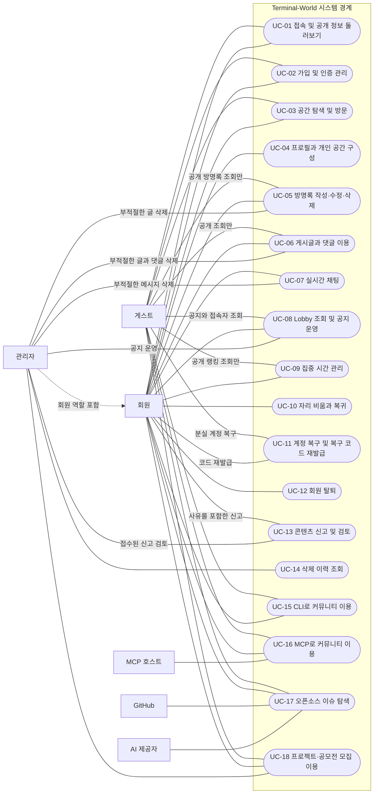
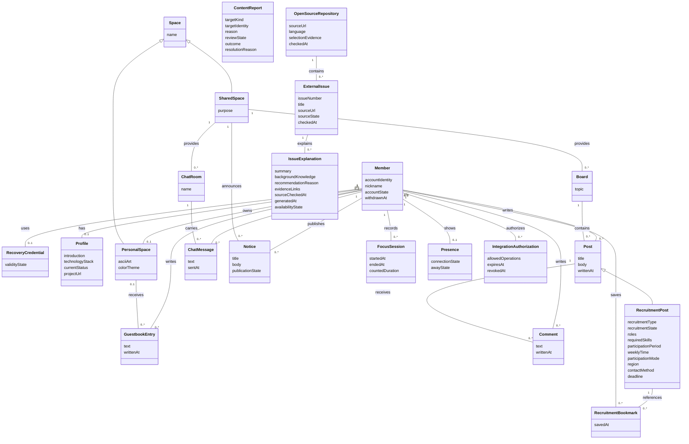

# Terminal-World 유스케이스 및 도메인 모델

- 작성일: 2026-10-26
- 상태: 요구사항 분석 산출물 개정본(2026-11-02)
- 기준: [요구사항 분석 명세](requirements-analysis.md)
- 범위: 기본 커뮤니티와 확정 추가 범위(CLI·MCP·이슈 탐색·모집 게시판)를 모델링한다. 보류 기능은 포함하지 않는다.
- 산출물 목록: [요구사항 분석 산출물 안내](analysis-deliverables.md)

## 1. 유스케이스 모델

### 1.1 액터

- **게스트:** 인증 없이 공개 정보를 조회하는 방문자.
- **회원:** 로그인 후 개인 공간 편집, 콘텐츠 작성, 채팅, 집중 기능을 이용하는 사용자.
- **관리자:** 회원 권한에 더해 공지 운영, 부적절한 콘텐츠 삭제, 신고 검토, 삭제 이력 조회를 수행하는 사용자.

관리자 지정·회수는 서비스 운영자의 별도 운영 절차로 수행한다. 일반 관리자는 지정·회수 권한이 없으며, 권한이 회수되면 기존 세션에서도 일반 회원 권한만 유지한다.

- **MCP 호스트:** 사용자의 요청과 허용 범위에 따라 기능을 호출하는 외부 AI 도구. 회원 권한을 독립적으로 소유하지 않는다.
- **GitHub:** 공개 저장소·이슈 자료 및 원문을 제공하는 외부 시스템.
- **AI 제공자:** 이슈 설명 생성을 지원하는 외부 시스템. 장애 시 원문 탐색은 유지한다.

### 1.2 시스템 경계와 유스케이스 관계

실선은 액터의 참여 관계이며 관리자→회원 점선은 회원 역할 포함을 나타낸다. 로그인은 인증이 필요한 유스케이스의 사전조건으로 둔다.

독립 도식: [Mermaid](diagrams/use-case.mmd) · [PlantUML](diagrams/use-case.puml). Mermaid는 flowchart로, PlantUML은 UML 액터·유스케이스·일반화로 표현한다.

각 유스케이스의 조회·작성·운영 권한은 상세 명세의 액터와 사전조건을 따른다.

## 2. 유스케이스 상세 명세

### 공통 규칙

| 항목 | 적용 기준 |
|---|---|
| 관리자 콘텐츠 삭제 | 명세 4절의 삭제 대상·필수 사유·이력을 적용한다. 관리자 권한·대상·사유를 확인하고 삭제 및 이력 기록이 확인된 뒤 완료를 표시한다. 본인 작성물·소유 공간 방명록 삭제는 회원 권한을 따른다. |
| 관리자 권한 | 공지 운영·콘텐츠 삭제·신고 검토·삭제 이력 조회 요청마다 현재 권한을 확인한다. 권한 회수 후에도 로그인과 일반 회원 권한은 유지한다. |
| 입력 | 계정은 명세 5.3절, 복구 코드는 5.5절, 프로필은 5.10절, 콘텐츠 길이는 5.11절, 일반 텍스트 문자·줄바꿈·표시는 5.12절을 따른다. 미리보기·붙여넣기·수정·저장에도 같은 검증을 적용하며 사용자 입력을 터미널 제어 명령으로 실행하지 않는다. |
| 보존·운영 | 백업·복구는 명세 5.7절, 별도 개인정보 삭제 요청은 5.8절, 운영 로그·요청 처리 기록은 5.9절을 따른다. 이 절차의 접근 권한은 서비스 운영자에게 있다. |
| 지원 환경 | 명세 5.13절과 CON-02를 적용한다. TUI는 목록 탐색을 항상 제공하며 CLI·MCP는 같은 업무 동작을 구조화된 입력·결과로 제공한다. |

CLI·MCP를 통한 UC-01~UC-14·UC-17~UC-18 실행은 UC-15·UC-16의 공통 접근 절차와 명세 5.15절을 따른다. 화면·키 조작은 명령과 구조화된 결과로 대응하며 기존 권한·민감 입력·최종 확인을 생략하지 않는다.

### UC-01 접속 및 공개 정보 둘러보기

- **관련 요구사항:** FR-01, FR-02
- **주 액터:** 게스트, 회원
- **목표·트리거:** 작업 중인 터미널에서 커뮤니티에 접속한다.
- **사전조건:** 지원 SSH 클라이언트와 네트워크가 있다.
- **성공 사후조건:** 진입 화면과 공개 정보를 조회할 수 있다.
- **기본 흐름:** ① 사용자가 SSH로 접속한다. ② 시스템이 게스트·가입·로그인 선택지를 표시한다. ③ 게스트를 선택하면 명세 4절의 공개 탐색 화면을 표시한다.
- **대안 흐름:** 가입·로그인은 UC-02로 이어진다. 인증된 회원도 공개 정보를 조회한다.
- **예외 흐름:** 접속 실패는 클라이언트 오류로, 접속 후 서비스 중단은 이용 불가로 안내한다. 게스트의 쓰기 요청에는 로그인을 안내한다.
- **실패 사후조건:** 회원 권한·개인 공간을 생성하거나 콘텐츠를 변경하지 않는다.

### UC-02 가입 및 인증 관리

- **관련 요구사항:** FR-03, FR-04, FR-05
- **주 액터:** 게스트(가입·로그인), 회원(로그아웃·비밀번호 변경)
- **목표·트리거:** 계정을 만들고 인증 상태를 관리한다.
- **사전조건:** 서비스에 접속했다. 가입·로그인은 미인증, 로그아웃·비밀번호 변경은 인증 상태다.
- **성공 사후조건:** 가입자는 계정·개인 공간과 로그인 상태를 얻는다. 로그인·로그아웃 결과가 해당 세션의 권한에 반영된다.
- **기본 흐름(가입):** ① 사용자가 아이디·닉네임·비밀번호를 입력한다. ② 시스템이 명세 5.3절로 형식·중복을 검사한다. ③ 계정·개인 공간을 생성하고 자동 로그인한다. 복구 코드 발급은 UC-11의 표시·보관 절차를 따른다.
- **대안 흐름(로그인·로그아웃):** 아이디·비밀번호와 재시도 제한을 확인하여 로그인한다. 로그아웃하면 해당 세션의 회원 권한을 종료한다.
- **대안 흐름(비밀번호 변경):** 현재 비밀번호를 확인하고 새 비밀번호를 검증·저장한다. 현재 세션·복구 코드는 유지하고 다른 세션과 모든 CLI·MCP 연동 자격을 무효화한다. 집중·접속 상태는 명세 5.2절·5.6절을 따른다.
- **예외 흐름:** 중복·누락·잘못된 형식은 정정을 안내한다. 인증 실패·재시도 제한은 명세 5.3절에 따르며 종료된 세션에는 재인증을 안내한다.
- **실패 사후조건:** 잘못된 가입 입력으로 계정을 생성하거나 실패한 인증으로 회원 권한을 부여하지 않는다.

### UC-03 공간 탐색 및 방문

- **관련 요구사항:** FR-06
- **주 액터:** 게스트, 회원
- **목표·트리거:** 공용 공간이나 다른 개발자의 개인 공간을 방문한다.
- **사전조건:** 서비스에 접속했고 대상 공간이 공개되어 있다.
- **성공 사후조건:** 선택한 공간의 상세 화면이 표시된다. 방문으로 편집 권한을 얻지 않는다.
- **기본 흐름:** ① 시스템이 공용·개인 공간을 구분한 2.5D 월드를 표시한다. ② 방향키로 이동·선택한다. ③ Enter로 진입하고 Esc로 탐색에 복귀한다.
- **대안 흐름:** 항상 제공되는 목록에서도 같은 키로 선택·진입·복귀한다. 개인 공간에서는 프로필을 조회하고 회원은 UC-05로 방명록을 작성한다. 공용 공간은 해당 기능으로 이어진다.
- **예외 흐름:** 공간이 없거나 조회에 실패하면 상세 진입을 중단하고 탐색을 계속하도록 안내한다.
- **실패 사후조건:** 사용자·공간 데이터는 바뀌지 않는다.
- **탐색 기준:** 확대·축소는 제공하지 않는다. 화면 크기는 명세 5.13절을 따른다.

### UC-04 프로필과 개인 공간 구성

- **관련 요구사항:** FR-07, FR-08, FR-20
- **주 액터:** 회원
- **목표·트리거:** 프로필과 개인 공간에 개발 정보·취향을 표현한다.
- **사전조건:** 로그인한 회원이 편집 대상 공간의 소유자다.
- **성공 사후조건:** 저장한 프로필·꾸미기가 공개 조회와 재접속에 반영된다.
- **기본 흐름:** ① 현재 프로필·꾸미기를 불러온다. ② 회원이 항목을 편집하고 ASCII 아트를 직접 입력하거나 프리셋을 고른다. ③ 테마를 선택하고 고정 레이아웃에서 미리 본다. ④ 시스템이 저장 요청의 권한·입력을 검사한 뒤 저장한다.
- **대안 흐름:** 미리보기는 공개 상태를 바꾸지 않는다. 편집을 계속하거나 취소할 수 있으며 취소하면 저장된 상태를 유지한다. 닉네임 외 항목은 비워둘 수 있다.
- **예외 흐름:** 잘못된 문자·길이·개수·URL은 정정을 안내하며 잘라 저장하지 않는다. 타인 공간 편집·만료 세션의 저장은 거부한다.
- **실패 사후조건:** 거부된 편집은 공개 상태에 반영되지 않는다.
- **입력 기준:** ASCII 아트·테마·고정 배치는 FR-08, 선택 프로필 항목은 명세 5.10절을 따른다.

### UC-05 방명록 작성·수정·삭제

- **관련 요구사항:** FR-09, FR-20
- **주 액터:** 게스트(조회), 회원(작성·본인 글 수정·권한별 삭제), 관리자(부적절한 글 삭제)
- **목표·트리거:** 개인 공간의 방명록을 조회·작성·관리한다.
- **사전조건:** 새 작성에는 로그인과 대상 공간이 필요하다. 수정은 작성자만, 삭제는 작성자·공간 소유자·부적절한 글을 관리하는 관리자만 할 수 있다.
- **성공 사후조건:** 작성자·내용·시각을 포함한 글 또는 수정 결과가 공개된다. 삭제한 글은 조회에서 제외된다.
- **기본 흐름:** ① 회원이 방명록을 입력한다. ② 시스템이 인증·대상·내용을 검사한다. ③ 저장하고 글을 표시한다.
- **대안 흐름:** 게스트도 공개 조회할 수 있다. 작성자는 본인 글을 수정하고 권한 보유자는 삭제한다. 취소 시 저장 상태를 유지한다. 공간 삭제 후 남은 타인 글은 ‘탈퇴한 사용자의 공간’ 보관 목록에서 조회하며 기존 작성자의 수정·삭제와 관리자 삭제를 허용한다.
- **예외 흐름:** 새 작성 시 대상 공간이 없으면 요청을 거부한다. 빈 내용·길이 초과는 수정을 안내하고 권한 없는 변경은 거부한다. 보관 목록의 새 작성과 공간 소유자·관리자의 타인 본문 수정을 거부한다. 이름을 재사용한 새 계정은 기존 글의 권한을 승계하지 않는다.
- **실패 사후조건:** 거부된 요청은 방명록을 변경하지 않는다.
- **보관 기준:** 공개 목록·권한은 명세 4절, 탈퇴·보존은 5.4절을 따른다.

### UC-06 게시글과 댓글 이용

- **관련 요구사항:** FR-10, FR-11, FR-12, FR-20
- **주 액터:** 게스트(조회), 회원(작성·본인 글 관리), 관리자(부적절한 글·댓글 삭제)
- **목표·트리거:** Cafe에서 개발 질문과 정보를 공유한다.
- **사전조건:** 조회는 공개 게시판에서, 작성은 로그인 후 이용한다. 수정·삭제는 본인 작성물에 한하며 관리자에게는 부적절한 콘텐츠 삭제를 허용한다.
- **성공 사후조건:** 글·댓글이 표시되거나 저장한 작성·수정·삭제 결과가 공개 조회에 반영된다.
- **기본 흐름:** ① FR-10의 게시판 중 하나를 선택한다. ② 글 목록에서 본문·댓글을 조회한다. ③ 회원이 댓글을 입력하면 시스템이 검증·저장한다.
- **대안 흐름:** 새 글 작성·본인 글 수정을 선택한다. 권한에 따라 글·댓글을 삭제하며 원글 삭제 시 댓글도 함께 삭제한다. 취소하면 기존 상태를 유지한다.
- **예외 흐름:** 대상 글이 없으면 목록으로 복귀하도록 안내한다. 게스트 쓰기·권한 없는 변경·잘못된 입력은 거부한다.
- **실패 사후조건:** 거부된 변경은 공개 콘텐츠에 반영되지 않는다.
- **공개 기준:** 게시글·댓글은 모두 공개하며 비밀글·대댓글은 제공하지 않는다.

### UC-07 실시간 채팅

- **관련 요구사항:** FR-13
- **주 액터:** 회원(송수신), 관리자(부적절한 메시지 삭제)
- **목표·트리거:** RoofTop에서 다른 회원과 대화한다.
- **사전조건:** 로그인한 회원이 RoofTop에 접속했다.
- **성공 사후조건:** 메시지의 작성자·내용이 수신 회원에게 수동 새로고침 없이 표시된다.
- **기본 흐름:** ① 입장·재접속 시 보존 기간 안의 삭제되지 않은 최근 100개를 표시한다. ② 회원이 메시지를 전송한다. ③ 시스템이 자격·입력을 검사하고 저장·전달한 뒤 전송 결과를 알린다.
- **대안 흐름:** 메시지를 실시간 수신하거나 전송 전 입력을 취소한다. 미확인 메시지는 사용자가 직접 재시도할 수 있으며 중복 저장·표시하지 않는다. 관리자는 부적절한 메시지를 삭제하고 이후 이력에서 제외한다.
- **예외 흐름:** 잘못된 입력·만료 세션은 전송을 거부한다. 결과 미확인 시 자동 재전송 없이 상태를 알린다. 조회 실패는 메시지 없음과 구분한다.
- **실패 사후조건:** 거부된 메시지는 공유되지 않으며 삭제된 메시지는 재시도로 복원되지 않는다.
- **보존 기준:** 전송 시각부터 14일 보존과 재시도·탈퇴·복구 처리는 FR-13 및 명세 5.7절을 따른다.

### UC-08 Lobby 조회 및 공지 운영

- **관련 요구사항:** FR-14, FR-15
- **주 액터:** 게스트·회원(공지·접속자 조회), 관리자(공지 운영)
- **목표·트리거:** 공지·접속 현황을 확인하거나 공지를 운영한다.
- **사전조건:** 서비스에 접속했으며 공지 운영에는 관리자 권한이 필요하다.
- **성공 사후조건:** 게시 중인 공지·접속자가 표시되거나 공지 운영 결과가 반영된다.
- **기본 흐름:** ① Lobby에서 공지와 접속 현황을 구분해 표시한다. ② 사용자가 공지를 선택하면 본문을 표시한다. 접속자 집계·단절 감지·재접속은 명세 5.2절을 따른다.
- **대안 흐름:** 관리자가 공지 작성·수정·게시 종료를 요청하면 시스템이 권한·입력을 검사하고 저장·목록 갱신을 마친다.
- **예외 흐름:** 일반 회원의 운영 요청은 거부한다.
- **실패 사후조건:** 권한·입력 검사를 통과하지 못한 요청은 공지를 바꾸지 않는다.

### UC-09 집중 시간 관리

- **관련 요구사항:** FR-16, FR-17, FR-18, FR-20
- **주 액터:** 회원(집중시간 추적·본인 기록·랭킹), 게스트(랭킹 조회)
- **목표·트리거:** Focus Room에서 작업 시간을 기록하고 일별 누적 시간·랭킹을 확인한다.
- **사전조건:** 추적·상세 기록 조회에는 로그인이 필요하다. 구간별 시작·중단 시각과 경과 시간은 본인만, 공개 랭킹은 게스트도 조회한다.
- **성공 사후조건:** 중단한 구간이 한 번만 기록되고 일별 누적 시간·랭킹에 반영된다.
- **기본 흐름:** ① 회원이 추적 시작을 선택한다. ② 시스템이 인증·진행 구간 중복을 검사한다. ③ 목표 시간 없이 경과 시간·당일 누적 시간을 표시한다. ④ 중단 시 명세 5.2절의 초 단위·날짜 분할 규칙으로 저장한다. ⑤ 회원이 기록·랭킹을 조회한다.
- **대안 흐름:** 추적 없이 기록·랭킹만 조회하거나 같은 계정의 다른 세션에서 진행 구간을 확인·중단한다. 진행 구간이 있으면 새 구간을 만들지 않는다. 기록 폐기·목표 시간 설정·만료 기능은 제공하지 않는다.
- **예외 흐름:** 시작 세션이 끊기면 마지막 연결 확인 시점까지만 기록하고 자동 재개하지 않는다. 다른 세션의 단절은 추적을 중단시키지 않는다. 타인 구간 변경·상세 조회는 관리자에게도 허용하지 않는다.
- **실패 사후조건:** 실패·중복 종료로 구간을 중복 합산하거나 타인 상세 기록을 노출하지 않는다.
- **집계 기준:** 시간 표시·초 미만 처리·한국 시간 자정 분할·공동 순위는 명세 5.2절을 따른다.

### UC-10 자리 비움과 복귀

- **관련 요구사항:** FR-19
- **주 액터:** 회원
- **목표·트리거:** 자리 비움과 복귀를 다른 사용자에게 알린다.
- **사전조건:** 로그인한 회원이다.
- **성공 사후조건:** 세션별 위치에서 도출한 회원의 통합 상태가 다른 사용자에게도 표시된다.
- **기본 흐름:** ① Living Room 입장 시 해당 세션을 자리 비움으로 전환한다. ② 모든 접속 세션이 Living Room에 있으면 회원을 자리 비움으로 표시한다. ③ 어느 세션에서든 다른 공간으로 이동하면 해제한다.
- **대안 흐름:** 상태가 같으면 그대로 유지한다. 일부 세션이 종료되면 남은 세션으로 다시 판단한다.
- **예외 흐름:** 마지막 세션 종료 시 오프라인으로 표시하며 비정상 단절도 감지한다. 재접속은 Lobby에서 시작한다. 타인 상태 변경은 거부한다.
- **실패 사후조건:** 권한 없는 요청은 타인 상태를 바꾸지 않는다.

### UC-11 계정 복구 및 복구 코드 재발급

- **관련 요구사항:** FR-22
- **주 액터:** 비밀번호를 분실한 방문자, 회원(코드 재발급)
- **목표·트리거:** 계정 접근권을 회복하거나 복구 코드를 교체한다.
- **사전조건:** 탈퇴하지 않은 계정이다. 복구에는 아이디·유효한 코드, 재발급에는 로그인·현재 비밀번호가 필요하다.
- **성공 사후조건:** 복구 시 새 비밀번호로 교체되고 모든 기존 세션이 종료된다. 복구·재발급 시 이전 코드는 무효화되고 새 코드가 발급된다.
- **기본 흐름:** ① 방문자가 아이디·복구 코드를 제출한다. ② 시스템이 제한·코드 유효성을 확인한다. ③ 새 비밀번호를 명세 5.3절로 검사하고 복구를 마친다. ④ 새 코드를 표시하고 아이디와 함께 보관하도록 안내한다. ⑤ 보관 확인 후 화면을 닫는다.
- **대안 흐름:** 로그인 회원은 현재 비밀번호 확인 후 코드를 재발급한다. 가입 시에도 같은 생성·표시·보관 절차를 사용한다.
- **예외 흐름:** 무효 코드·탈퇴 계정은 거부한다. 없는 아이디와 잘못된 코드는 같은 실패 안내를 사용한다. 실패 제한·동시 사용은 명세 5.5절을 따른다. 비밀번호·코드 모두 분실 시 복구할 수 없으며 관리자 임의 초기화는 제공하지 않는다.
- **실패 사후조건:** 유효한 본인 확인 없이 계정 접근권을 얻을 수 없다.
- **코드 기준:** 형식·입력·일회 표시·저장·유효성은 명세 5.5절을 따른다. 아이디 검색은 제공하지 않는다.

### UC-12 회원 탈퇴

- **관련 요구사항:** FR-23
- **주 액터:** 회원
- **목표·트리거:** 계정 이용을 종료하고 개인정보 삭제 절차를 시작한다.
- **사전조건:** 로그인한 본인이다.
- **성공 사후조건:** 계정 이용이 종료되고 세션·복구 코드가 무효화된다. 프로필·공간·집중 기록 삭제, 남는 작성물 표시·보존은 명세 5.4절을 따른다.
- **기본 흐름:** ① 회원이 탈퇴를 선택한다. ② 현재 비밀번호를 확인한다. ③ 삭제·보존·90일 처리 범위를 안내한다. ④ 최종 확인 후 탈퇴하고 결과를 알린다. ⑤ 명세 5.4절의 기한에 맞춰 개인정보·식별 연결을 삭제하고 이름 재사용을 허용한다.
- **대안 흐름:** 최종 확인 전 철회하면 계정을 유지한다.
- **예외 흐름:** 본인 확인 실패는 거부한다. 탈퇴 계정의 로그인·복구는 차단한다.
- **실패 사후조건:** 확인을 통과하지 못한 요청으로 계정이 탈퇴되지 않는다.
- **운영 기준:** 별도 개인정보 삭제 요청은 명세 5.8절, 운영 로그·처리 기록은 5.9절을 따른다.

### UC-13 콘텐츠 신고 및 검토

- **관련 요구사항:** FR-24
- **주 액터:** 회원(신고), 관리자(검토)
- **목표·트리거:** 회원이 부적절하다고 판단한 게시글·댓글·방명록·채팅을 신고하고 관리자가 검토한다.
- **사전조건:** 신고자는 로그인했고 대상 조회 권한이 있다. 검토자는 관리자다.
- **성공 사후조건:** 신고는 ‘접수’로 기록되며 검토 후 결과(삭제/조치 없음)·사유와 함께 ‘검토 완료’로 바뀐다. 신고자는 본인 신고만 조회한다.
- **기본 흐름:** ① 회원이 대상·사유를 제출한다. ② 시스템이 인증·대상·사유·중복·빈도를 검사하고 저장 후 접수를 알린다. ③ 관리자가 대상·사유를 검토한다. ④ 결과·사유를 저장한 뒤 검토를 완료한다. 삭제 결정 시에는 해당 삭제의 완료도 확인한다. ⑤ 신고자가 본인 화면에서 결과를 확인한다.
- **대안 흐름:** 접수 전 취소하면 신고를 남기지 않는다. 삭제 결정은 UC-05·UC-06·UC-07의 삭제 흐름과 사유·이력 기록으로 이어진다. ‘조치 없음’ 결정은 콘텐츠를 변경하지 않는다.
- **예외 흐름:** 게스트 신고·사유 누락·한도 초과·일반 회원의 검토 접근·타인 신고 조회를 거부한다. 중복 요청에는 기존 신고 상태를 안내한다. 검토 전 대상이 삭제되면 ‘조치 없음/대상 삭제됨’으로 완료한다. 저장이 확인되지 않은 접수·검토는 완료로 표시하지 않는다.
- **실패 사후조건:** 거부·실패한 신고는 콘텐츠·계정 상태를 바꾸거나 다른 신고자 정보를 노출하지 않는다.
- **접수·보존 기준:** 명세 5절의 FR-24 신고 제한·FR-24/FR-25 기록 보존을 따른다. 신고 접수만으로 자동 삭제·제재하지 않으며 결과는 푸시 없이 본인 조회로 제공한다.

### UC-14 삭제 이력 조회

- **관련 요구사항:** FR-25
- **주 액터:** 관리자
- **목표·트리거:** 콘텐츠 삭제 처리 내역을 확인한다.
- **사전조건:** 현재 관리자 권한이 있는 인증 세션이다.
- **성공 사후조건:** 보존 기간 안의 삭제 이력에서 처리 관리자·대상 식별자·처리 시각·사유를 조회한다. 삭제 기한이 지난 계정 연결은 표시하지 않는다. 조회는 콘텐츠·이력을 변경하지 않는다.
- **기본 흐름:** ① 관리자가 이력 조회를 요청한다. ② 시스템이 현재 권한을 확인하고 목록을 표시한다.
- **대안 흐름:** 이력이 없으면 ‘이력 없음’을 표시한다. 일반 회원의 본인 신고 결과는 UC-13으로 조회한다.
- **예외 흐름:** 게스트·일반 회원·관리자 권한이 회수된 세션의 조회를 거부한다. 조회 실패는 이력 없음과 구분한다.
- **실패 사후조건:** 비인가 요청에 이력을 노출하지 않으며 콘텐츠·이력은 바뀌지 않는다.
- **보존 기준:** 명세 5절의 FR-24/FR-25 기록 보존과 5.7절의 백업·복구 기준을 따른다.

### UC-15 CLI로 커뮤니티 이용

- **관련 요구사항:** FR-26, FR-28
- **주 액터:** 게스트, 회원(관리자 역할 포함)
- **목표·트리거:** 작업 중인 명령줄에서 커뮤니티 업무를 수행한다.
- **사전조건:** CLI와 네트워크를 사용할 수 있다. 보호된 작업에는 유효한 인증·허용 범위가 필요하다.
- **성공 사후조건:** 요청한 업무의 결과가 공통 데이터에 반영되며 결과와 종료 상태를 확인한다.
- **기본 흐름:** ① 도움말에서 기능과 입력을 확인한다. ② 업무 명령과 인수·파일/표준입력을 전달한다. ③ 시스템은 계정·자격·현재 권한·입력을 검사한다. ④ 해당 유스케이스를 실행한다. ⑤ 사람이 읽는 결과 또는 구조화된 결과를 반환한다.
- **대안 흐름:** 공개 조회는 게스트로 이용한다. 회원은 직접 인증 후 연동 범위·유효성을 확인하고 자격을 발급·조회·회수한다. 채팅·집중은 지속 세션을 명시적으로 연다. 민감 입력·최종 확인은 사용자에게 직접 요청한다.
- **예외 흐름:** 자격 만료·회수·권한 부족·입력 오류는 실행 전에 거부한다. 결과 미확인은 성공과 구분하며 재시도로 중복 쓰기하지 않는다. 연결 단절 시 집중 집계는 기존 규칙을 따른다.
- **실패 사후조건:** 비인가 변경·자격 원문 노출이 없고 실패/미확인 상태를 반환한다.

### UC-16 MCP로 커뮤니티 이용

- **관련 요구사항:** FR-27, FR-28
- **주 액터:** 게스트, 회원(관리자 역할 포함)
- **보조 액터:** MCP 호스트
- **목표·트리거:** AI 도구에서 사용자가 허용한 커뮤니티 작업을 수행한다.
- **사전조건:** 호스트가 MCP 서버에 연결되어 있으며 보호된 작업은 유효한 연동 자격이 있다.
- **성공 사후조건:** 공통 데이터에 작업 결과가 반영되고 근거·성공/실패 상태를 호스트에서 확인한다.
- **기본 흐름:** ① 호스트가 도구와 입출력 설명을 조회한다. ② 사용자 요청에 따라 작업을 선택한다. ③ 시스템은 현재 계정 권한·허용 작업·자격 유효성·입력을 검사한다. ④ 해당 유스케이스를 실행하고 구조화된 결과를 반환한다.
- **대안 흐름:** 공개 조회는 게스트 권한으로 수행한다. 회원은 사용자 인증 절차에서 자격을 관리한다. 지속 작업은 세션/구독으로 이용한다. 보호된 입력을 제공할 수 없는 호스트에서는 사용자 인증 절차로 인계한다.
- **예외 흐름:** 허용되지 않은 쓰기·회수 자격·관리자 권한 회수·잘못된 입력은 거부한다. 외부 글/이슈의 지시는 실행 권한으로 인정하지 않는다. 생성·통신 실패를 완료로 보고하지 않는다.
- **실패 사후조건:** 승인되지 않은 업무를 실행하거나 모델에 비밀번호·복구 코드·자격 원문을 전달하지 않는다.

### UC-17 오픈소스 이슈 탐색

- **관련 요구사항:** FR-29, FR-30
- **주 액터:** 게스트, 회원
- **보조 액터:** GitHub, AI 제공자
- **목표·트리거:** 중·소규모·신생 오픈소스에서 관심과 기술에 맞는 기여 기회를 찾는다.
- **사전조건:** 공개 이슈 탐색에 접근했다. 로그인·비공개 저장소 접근 권한은 필수가 아니다.
- **성공 사후조건:** 후보 이슈와 추천 근거를 검토하고 원하는 GitHub 원문에 접근할 수 있다.
- **기본 흐름:** ① 언어·분야·관심 키워드를 지정한다. ② 시스템은 선정 규칙과 확인 시점에 따라 열린 후보를 표시한다. ③ 사용자가 이슈를 선택한다. ④ 원문 정보와 AI 요약·배경지식·추천 이유 및 근거 시점을 확인한다. ⑤ 원문 URL을 선택해 GitHub에서 최신 상태를 확인한다.
- **대안 흐름:** 결과가 없으면 조건을 바꾼다. AI 설명이 없더라도 원문 정보로 탐색한다. CLI·MCP에서도 같은 자료를 조회한다.
- **예외 흐름:** 외부 장애·요청 한도·지연은 결과 없음과 구분한다. 닫힘·삭제·접근 불가가 확인된 이슈는 현재 후보에서 제외한다. 미확인 상태·근거 부족·추론을 사실이나 참여 가능으로 단정하지 않는다.
- **실패 사후조건:** GitHub 쓰기·코드 실행·수정 준비는 발생하지 않으며 마지막 확인 자료에는 최신 여부를 명시한다.

### UC-18 프로젝트·공모전 모집 이용

- **관련 요구사항:** FR-31
- **주 액터:** 게스트(공개 조회), 회원(작성·본인 관리·저장), 관리자(부적절한 글 삭제)
- **목표·트리거:** 참여할 팀이나 함께할 팀원을 찾는다.
- **사전조건:** 조회는 공개이며 작성·저장은 인증, 수정·마감은 작성자 권한이 필요하다.
- **성공 사후조건:** 모집글·상태·본인 관심 목록이 저장되고 공개 조회 및 재접속에 반영된다.
- **기본 흐름:** ① 유형·역할·기술·방식·상태로 모집글을 탐색한다. ② 상세 조건과 공개 연락 방식을 확인한다. ③ 관심 글을 저장하거나 외부 연락 방식으로 지원한다.
- **대안 흐름:** 회원은 필수 모집 항목과 공개 범위를 확인하고 게시한다. 작성자는 수정·삭제·마감한다. 마감 시각 도달 시 시스템이 마감하고 목록에 반영한다. 본인 저장은 해제할 수 있다. 댓글은 UC-06, 신고는 UC-13, 관리 삭제는 기존 공통 규칙을 따른다.
- **예외 흐름:** 필수 정보 누락·잘못된 입력·타인 글 변경·타인의 저장 목록 조회를 거부한다. 삭제된 글은 조회·저장을 허용하지 않고 기존 저장 연결을 제거한다.
- **실패 사후조건:** 기존 글·상태·저장을 임의 변경하지 않으며 지원 접수·선발·팀 관리는 생성하지 않는다.

## 3. 도메인 모델

### 3.1 개념과 속성

업무 개념과 속성, 관계, 다중성을 나타낸다.

독립 도식: [Mermaid](diagrams/domain-model.mmd) · [PlantUML](diagrams/domain-model.puml). 두 형식은 동일한 모델을 표현하며 생애주기는 3.2절을 따른다.

### 3.2 관계와 다중성 해석

- **회원·프로필·개인 공간:** 활동 회원은 Profile·PersonalSpace를 각각 하나 가진다. 탈퇴 시 삭제되므로 회원이 가지는 프로필·공간 수는 각각 0..1로 표현한다. 게스트는 Member에 포함하지 않는다.
- **복구 자격:** 활동 계정에 유효한 RecoveryCredential 하나가 있으며 탈퇴 계정에는 없다. 코드 원문 대신 검증용 값을 저장한다. 교체·유효성은 명세 5.5절을 따른다.
- **방명록:** 새 GuestbookEntry는 존재하는 PersonalSpace에 작성한다. 공간 삭제 후에도 타인의 글을 공개 보관하므로 대상 공간 다중성은 0..1이다. 보관 목록에 새 글을 받거나 삭제된 글을 복원하지 않는다. 작성자·공간 소유자·관리자 권한과 탈퇴 표시는 명세 4절·5.4절을 따른다.
- **게시글·댓글·작성자:** Post는 Board 하나, Comment는 Post 하나에 속한다. 활동 중 작성자는 한 명이며 탈퇴 후 계정 연결을 제거하므로 작성 회원 다중성은 0..1이다. 남는 본문을 이름 재사용 계정에 연결하지 않는다. 원글 삭제 시 댓글도 삭제하며 탈퇴 자체는 원글 삭제와 구분한다.
- **공용 공간:** Cafe는 Board, RoofTop은 ChatRoom, Lobby는 Notice를 제공한다. Focus Room·Living Room은 각각 집중·자리 비움 기능의 공용 공간이다. 집중 기록은 공간이 아닌 회원에게 속한다.
- **채팅·공지:** ChatMessage는 ChatRoom 하나에 속하며 sentAt이 보존의 기준 시각이다. Notice 작성자는 관리자 역할이 있는 Member다. 채팅 보존은 FR-13, 관리자 역할은 명세 4절을 따른다.
- **콘텐츠 신고:** ContentReport의 targetKind·targetIdentity는 대상 종류·식별자, reason은 신고 사유다. reviewState는 접수·검토 완료이며 outcome·resolutionReason은 완료 시 기록하는 결과·처리 사유다. 접수 중에는 이 두 값이 미정이다. 관리자는 신고를 검토하고 신고자는 본인 신고만 조회한다.
- **신고 중복:** 동일 회원·콘텐츠 조합은 한 번만 신고하며 다른 회원의 신고는 별도 ContentReport다. 빈도 집계 초기화·신고 기록 삭제·계정 연결 제거 후에도 동일 콘텐츠 재신고 제한과 개인정보 삭제 기한을 함께 지킨다. 이를 위해 삭제한 신고 이력을 복원하지 않는다. 접수·보존 기준은 명세 5절의 FR-24 상세 기준을 따른다.
- **삭제 이력:** 처리 관리자·대상 식별자·처리 시각·사유를 담는 업무 기록이며 관리자만 전체 조회한다. 계정 연결 삭제와 기록 보존은 별개다. 명세 5절의 FR-24/FR-25 기록 보존을 따르며 삭제 본문 사본은 보관하지 않는다.
- **집중 기록:** Member는 FocusSession을 여러 개 가지며 진행 구간은 최대 하나다. 진행 중 endedAt·countedDuration은 미정이다. 상세는 본인만 조회한다. 일별 합계·랭킹은 기록에서 도출하며 닉네임·순위·당일 누적 시간만 공개한다. 집계는 명세 5.2절을 따른다.
- **접속·프로필 상태:** Presence는 여러 세션의 위치에서 도출한 회원의 통합 접속·자리 비움 상태다. Profile.currentStatus는 사용자가 쓰는 소개성 문구다. 상태 계산은 명세 5.2절을 따른다.
- **프로필·꾸미기:** Profile의 introduction·technologyStack·currentStatus·projectUrl은 선택 항목이며 projectUrl은 표시용 주소다. ASCII 아트·테마는 PersonalSpace.asciiArt·colorTheme에 대응한다. 입력 기준은 명세 5.10절·FR-08을 따른다.
- **탐색·연관:** 월드와 목록은 동일한 Space를 찾는 두 표현이다. 관계는 일반 연관으로 나타내며 개체별 삭제·보존은 명세 5.4절과 FR-24/FR-25 상세 기준을 따른다.

- **연동 자격:** IntegrationAuthorization은 회원 한 명의 허용 작업·만료·회수 상태를 표현한다. 단순 자격 보유는 Presence가 아니며 실제 권한은 계정의 현재 권한과 허용 범위의 교집합이다. 무효화는 명세 5.15절과 계정 정책을 따른다.
- **외부 이슈:** OpenSourceRepository에 ExternalIssue가 속한다. GitHub가 원본이며 상태·확인 시점을 가진 참조 자료다. IssueExplanation은 특정 이슈 자료 시점에 기반한 설명으로 생성 시점·근거·미확인 상태를 포함한다. 외부 저장소 관리자와 Terminal-World 회원을 동일 인물로 추정하지 않는다.
- **모집글:** RecruitmentPost는 Post의 특수화다. 모집 상태·역할·참여 조건·연락 방식·선택 마감 시각을 추가하며 기존 댓글·신고·작성자·삭제 규칙을 상속한다. RecruitmentBookmark는 회원 한 명과 모집글 하나를 연결하며 조합별 하나다. 글 삭제·회원 탈퇴 시 해당 저장을 삭제한다.

### 3.3 용어 대응

| 기획 용어 | 모델 개념 | 관련 요구사항 |
|---|---|---|
| 개발자 계정 | Member | FR-03, FR-04 |
| 계정 복구 자격 | RecoveryCredential | FR-22 |
| 계정 탈퇴 생애주기 | Member | FR-23 |
| 개발 프로필 | Profile | FR-07, FR-08 |
| 개인 터미널 | PersonalSpace | FR-05, FR-06, FR-07, FR-08 |
| 목적별 공용 공간 | SharedSpace | FR-06, FR-14, FR-16, FR-19 |
| 개인 공간 방명록 | GuestbookEntry | FR-09 |
| Cafe의 게시판·게시글·댓글 | Board, Post, Comment | FR-10, FR-11, FR-12 |
| RoofTop 채팅 | ChatRoom, ChatMessage | FR-13 |
| 콘텐츠 신고 | ContentReport | FR-24 |
| Lobby 공지 | Notice | FR-14, FR-15 |
| 집중시간 추적 구간·집중 기록 | FocusSession | FR-16, FR-17, FR-18 |
| 접속·자리 비움 | Presence | FR-14, FR-19 |
| 연동 자격 | IntegrationAuthorization | FR-28 |
| 공개 저장소·이슈 | OpenSourceRepository, ExternalIssue | FR-29 |
| AI 이슈 설명 | IssueExplanation | FR-30 |
| 모집글·개인 저장 | RecruitmentPost, RecruitmentBookmark | FR-31 |
