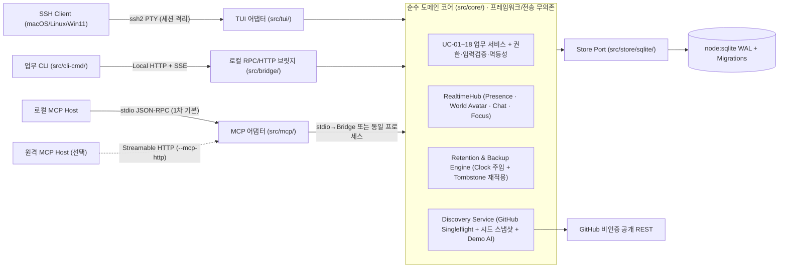
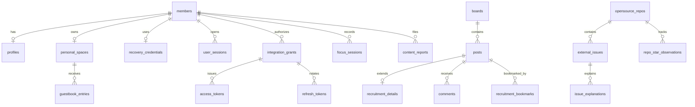
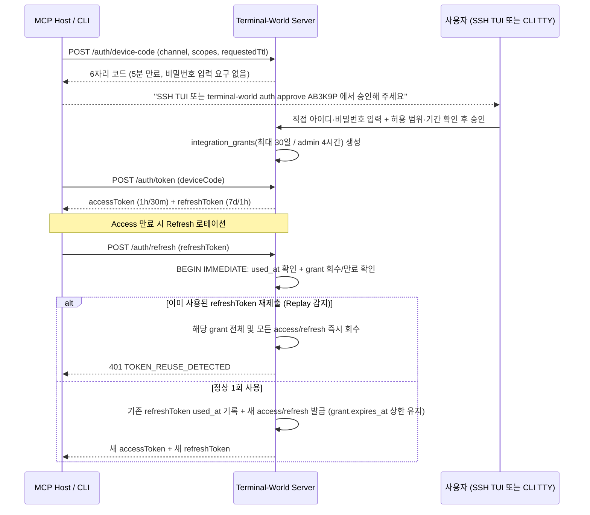

# Terminal-World 아키텍처 및 데이터 설계 명세

- 작성일: 2026-11-28 (Asia/Seoul)
- 상태: **확정 (2단계 공통 구조 설계 산출물)**
- 채택 아키텍처: **초안 C — 모듈형 모놀리스 + 2단계 어댑터형**
- 기준 문서: [요구사항 분석 명세](requirements-analysis.md), [유스케이스·도메인 모델](analysis-models.md), [설계 결정 기록](design-decisions.md), [전체 기능 데모 계획](demo-plan.md)
- 관련 문서: [인터페이스 및 화면 설계 명세](interface-spec.md)

> 본 문서는 확정 요구사항(FR 30개, UC 18개)과 2026-11-08·2026-11-28 사용자 결정을 구현하기 위한 서버·데이터·인증·보존·테스트 설계 명세다. 5.14절의 성능·RPO/RTO 수치 제외 결정과 2026-11-02 보류·제외 범위는 그대로 유지한다.

---

## 1. 시스템 아키텍처 개요

### 1.1 모듈형 모놀리스와 포트/어댑터 경계

단일 Node.js(`>=22`, 검증 환경 `v24.15.0`) 서버 프로세스(`terminal-world serve`) 안에 **순수 도메인 코어(`src/core/`)**와 영속 저장소(`node:sqlite`)를 두고, 세 인터페이스(SSH TUI · 업무 CLI · MCP)가 모두 동일한 공통 업무 서비스를 호출한다. 어떤 인터페이스도 독자적인 데이터 사본이나 권한 예외를 갖지 않는다.

### 1.2 패키지 및 디렉터리 구조

| 경로 | 책임 | 의존 규칙 |
|---|---|---|
| `src/service/validation.ts` | 공통 입력 검증(5.3, 5.10~5.12, FR-08) — 기존 구현 재사용·확장 | 순수 TS, 외부 의존 없음 |
| `src/core/` | 도메인 엔티티, 포트 인터페이스(`Clock`, `Store`, `RealtimeHub`, `GitHubClient`, `IssueExplainer`), UC-01~18 업무 서비스, 권한/토큰/멱등성 정책 | `src/service/validation.ts`, `node:crypto`만 참조 (Ink/HTTP/SSH/MCP 금지) |
| `src/store/sqlite/` | `node:sqlite` 기반 `Store` 구현, SQL 마이그레이션, 트랜잭션 래퍼, Tombstone 및 `VACUUM INTO` 백업/복구 | `node:sqlite`, `src/core/` |
| `src/discovery/` | GitHub 비인증 공개 REST 클라이언트(ETag·한도 헤더·Singleflight·직렬 큐), 시드 스냅샷 로더, `DemoIssueExplainer` | `fetch`, `src/core/` |
| `src/bridge/` | 로컬 HTTP/JSON + SSE 서버(`127.0.0.1` 기본 바인딩). CLI와 외부 `stdio` MCP 어댑터가 공유 서버에 연결하는 얇은 전송 경계 | `node:http`, `src/core/` |
| `src/ssh/` | `ssh2` 내장 SSH 서버. 접속별 PTY 스트림을 독립 Ink 인스턴스와 React ErrorBoundary로 격리하여 단일 세션 장애가 서버에 전파되지 않게 함 | `ssh2`, `src/tui/`, `src/core/` |
| `src/tui/` | 2.5D 아바타 자유 이동 맵 + 목록 탐색 + 전체 공간/관리/이슈/인증 화면, 멀티라인 입력기, 4테마 미리보기 | `ink`, `react`, `src/core/` |
| `src/cli-cmd/` | 비대화형 업무 CLI(`terminal-world <resource> <action>`), JSON/사람용 포매터, TTY 보호 입력, SSE 지속 구독 | `src/bridge/` 클라이언트 |
| `src/mcp/` | MCP 도구 정의(`tools.ts`, 전송 무의존) + `stdio` 진입점(기본) + 선택적 `Streamable HTTP` 어댑터(`--mcp-http`) | `@modelcontextprotocol/sdk`, `zod`, `src/core/` 또는 `src/bridge/` |
| `src/server.ts` | `terminal-world serve` 통합 부트스트랩(마이그레이션, 복구 재적용 검사, SSH/Bridge/선택적 MCP HTTP 기동, 정상 종료 시 활성 집중 구간 마감) | 최상위 조립 계층 |

### 1.3 추가 외부 의존성 경계

기존 의존성(`ink`, `react`, `@ink-tools/ink-mouse`, `xterm-mouse`, `string-width`) 외에 신규 외부 패키지는 **3개**로 제한한다.

| 패키지 | 도입 사유 |
|---|---|
| `ssh2` | OS `sshd` 설정 없이 Node 프로세스 안에서 표준 OpenSSH 클라이언트(macOS·Linux·Windows 11)의 PTY 접속을 직접 수용 |
| `@modelcontextprotocol/sdk` | MCP `2025-11-25` 규격의 도구 발견·JSON-RPC `stdio` 및 선택적 `Streamable HTTP` 전송 표준 구현 |
| `zod` | MCP 도구 입출력 스키마 선언 및 Bridge HTTP 요청 경계의 구조 검증 (도메인 규칙 자체는 `validation.ts`가 단일 진실 공급원) |

- 영속 저장: Node 22.5+/24 내장 **`node:sqlite`** (`DatabaseSync`, WAL 모드, 외래 키 `ON`) — 네이티브 컴파일러 의존성 없음.
- 비밀번호·토큰·복구 코드 해싱: Node 내장 **`node:crypto`** (`scrypt` + 무작위 salt, 토큰/코드는 `sha256` 해시 + `timingSafeEqual`).

> 기존 로컬 프로토타입 데이터(`~/Library/Application Support/Terminal World/state.json`)는 건드리지 않으며, 신규 서버 데이터는 별도 디렉터리(기본 `./.terminal-world-data/` 또는 `--data-dir`)에 SQLite 파일(`world.db`)과 백업(`backups/`)을 저장한다.

---

## 2. 데이터 모델 및 SQLite 스키마 (ERD)

### 2.1 핵심 개념 매핑과 영속 테이블

### 2.2 테이블별 상세 명세 및 제약조건

모든 시각은 UTC ISO-8601(`YYYY-MM-DDTHH:mm:ss.sssZ`) 문자열로 저장하고, 일별 집중 분할 및 모집 마감 시각 해석에만 명시적으로 `Asia/Seoul`(UTC+09:00)을 적용한다.

#### (1) 계정 · 인증 · 세션 · 연동 자격
- **`members`**
  - `id TEXT PRIMARY KEY` (UUIDv4)
  - `login_id TEXT NOT NULL`, `login_id_key TEXT NOT NULL UNIQUE` (소문자 정규화 — 동시 가입 중복 DB 레벨 차단)
  - `nickname TEXT NOT NULL`, `nickname_key TEXT NOT NULL UNIQUE` (NFC + 소문자 정규화)
  - `password_hash TEXT NOT NULL` (`scrypt` 파라미터·salt·derivedKey 직렬화)
  - `role TEXT NOT NULL CHECK (role IN ('member', 'admin'))`
  - `role_version INTEGER NOT NULL DEFAULT 1` (관리자 권한 회수 시 증가)
  - `state TEXT NOT NULL CHECK (state IN ('active', 'withdrawn'))`
  - `failed_login_count INTEGER NOT NULL DEFAULT 0`, `login_locked_until TEXT`
  - `failed_recovery_count INTEGER NOT NULL DEFAULT 0`, `recovery_locked_until TEXT`
  - `created_at TEXT NOT NULL`, `withdrawn_at TEXT`, `pii_purge_at TEXT` (`withdrawn_at + 90d`)
  - 탈퇴 후 90일 경과 시 `pii_purge_at <= now` 배치에서 `members` 행의 개인정보(`login_id`, `login_id_key`, `nickname`, `nickname_key`, `password_hash`)를 완전 제거(또는 `name_reservations` 만료 후 행 삭제)하여 아이디·닉네임 재사용을 허용한다.
- **`name_reservations`** (탈퇴 후 90일 이름 재사용 제한 전용)
  - `kind TEXT NOT NULL CHECK (kind IN ('login_id', 'nickname'))`
  - `lookup_key TEXT NOT NULL`, `reserved_until TEXT NOT NULL`
  - `PRIMARY KEY (kind, lookup_key)` — 90일 만료 후 삭제되어 새 계정이 재사용 가능하며, 기존 작성물은 `author_member_id = NULL`이므로 권한 승계가 원천 차단된다.
- **`recovery_credentials`**
  - `member_id TEXT PRIMARY KEY REFERENCES members(id) ON DELETE CASCADE`
  - `code_hash TEXT NOT NULL`, `issued_at TEXT NOT NULL`, `consumed_at TEXT`
  - 동시 복구 방지: `UPDATE recovery_credentials SET consumed_at = ? WHERE member_id = ? AND code_hash = ? AND consumed_at IS NULL`의 `changes === 1`인 트랜잭션만 성공.
- **`user_sessions`** (지속 업무 세션 — SSH TUI / CLI 지속 구독 / MCP 지속 세션만 기록)
  - `id TEXT PRIMARY KEY`, `member_id TEXT REFERENCES members(id) ON DELETE CASCADE` (게스트는 `NULL`, `is_guest = 1`)
  - `channel TEXT NOT NULL CHECK (channel IN ('ssh', 'cli', 'mcp'))`
  - `current_space_id TEXT NOT NULL` (기본 `'space:lobby'`, Living Room이면 `'space:living'`)
  - `world_x INTEGER NOT NULL DEFAULT 10`, `world_y INTEGER NOT NULL DEFAULT 6` (2.5D 아바타 좌표)
  - `last_heartbeat_at TEXT NOT NULL`, `created_at TEXT NOT NULL`, `ended_at TEXT`, `end_reason TEXT`
- **`auth_approval_codes`** (SSH/CLI 브라우저 비의존 6자리 원타임 승인 코드)
  - `code TEXT PRIMARY KEY` (6자리 혼동 문자 제외 대문자/숫자, 5분 만료)
  - `requested_channel TEXT NOT NULL CHECK (requested_channel IN ('cli', 'mcp'))`
  - `requested_scopes TEXT NOT NULL` (JSON 배열: `read`, `write`, `admin`)
  - `requested_ttl_sec INTEGER NOT NULL`, `client_label TEXT NOT NULL`
  - `status TEXT NOT NULL CHECK (status IN ('pending', 'approved', 'denied', 'exchanged', 'expired'))`
  - `approved_grant_id TEXT REFERENCES integration_grants(id)`
  - `expires_at TEXT NOT NULL`, `created_at TEXT NOT NULL`
- **`integration_grants`** (CLI/MCP 연동 승인 — 절대 수명 관리)
  - `id TEXT PRIMARY KEY`, `member_id TEXT NOT NULL REFERENCES members(id) ON DELETE CASCADE`
  - `channel TEXT NOT NULL CHECK (channel IN ('cli', 'mcp'))`, `label TEXT NOT NULL`
  - `scopes TEXT NOT NULL` (JSON: `read`, `write`, `admin`)
  - `expires_at TEXT NOT NULL` (**일반 최대 30일, `admin` 포함 시 최대 4시간 — 절대 연장 불가**)
  - `revoked_at TEXT`, `revoked_reason TEXT`, `created_at TEXT NOT NULL`
- **`access_tokens`**
  - `token_hash TEXT PRIMARY KEY`, `grant_id TEXT NOT NULL REFERENCES integration_grants(id) ON DELETE CASCADE`
  - `expires_at TEXT NOT NULL` (`min(now + 1h, grant.expires_at)`, 관리자 범위 포함 시 `min(now + 30m, grant.expires_at)`)
  - `revoked_at TEXT`, `created_at TEXT NOT NULL`
- **`refresh_tokens`** (일회용 로테이션 + 재사용 탐지)
  - `token_hash TEXT PRIMARY KEY`, `grant_id TEXT NOT NULL REFERENCES integration_grants(id) ON DELETE CASCADE`
  - `family_id TEXT NOT NULL`, `replaced_by_hash TEXT`
  - `expires_at TEXT NOT NULL` (`min(now + 7d, grant.expires_at)`, 관리자 범위 포함 시 `min(now + 1h, grant.expires_at)`)
  - `used_at TEXT`, `revoked_at TEXT`, `created_at TEXT NOT NULL`

#### (2) 프로필 · 개인 공간 · 방명록
- **`profiles`**: `member_id PK`, `introduction`, `technology_stack_json`, `current_status`, `project_url`, `updated_at` (탈퇴 시 삭제)
- **`personal_spaces`**: `id PK`, `member_id UNIQUE`, `ascii_art`, `color_theme` (`dark`|`light`|`green`|`amber`), `grid_slot INTEGER UNIQUE` (2.5D 월드 내 개인 공간 슬롯 좌표), `updated_at` (탈퇴 시 삭제)
- **`guestbook_entries`**: `id PK`, `target_space_id TEXT` (공간 삭제 후 `NULL` 전환 → `'탈퇴한 사용자의 공간'` 공개 보관 목록으로 조회), `author_member_id TEXT` (작성자 탈퇴 시 `NULL` 전환 → `'탈퇴한 사용자'`), `body TEXT NOT NULL`, `created_at`, `updated_at`, `deleted_at`

#### (3) 게시판 · 모집 · 댓글 · 공지 · 채팅
- **`boards`**: 고정 시드 7개 (`free`, `dev-qna`, `info`, `mcp`, `skills`, `opensource`, `recruitment`)
- **`posts`**: `id PK`, `board_id FK`, `author_member_id` (탈퇴 시 `NULL`), `title`, `body`, `created_at`, `updated_at`, `deleted_at`
- **`recruitment_details`**: `post_id PK FK(posts ON DELETE CASCADE)`, `recruitment_type` (`project`|`contest`|`hackathon`), `recruitment_state` (`open`|`closed`), `progress_note`, `roles_json`, `required_skills_json`, `no_skill_required INTEGER`, `participation_period`, `weekly_time`, `participation_mode` (`online`|`offline`|`hybrid`), `region`, `contact_method`, `deadline_at` (UTC 저장, 입력·비교 시 Asia/Seoul 해석)
- **`recruitment_bookmarks`**: `member_id`, `post_id`, `saved_at`, `PRIMARY KEY (member_id, post_id)` (글 삭제·회원 탈퇴 시 CASCADE 삭제)
- **`comments`**: `id PK`, `post_id FK(posts ON DELETE CASCADE)`, `author_member_id` (탈퇴 시 `NULL`), `body`, `created_at`, `updated_at`, `deleted_at`
- **`notices`**: `id PK`, `author_member_id`, `title`, `body`, `publication_state` (`published`|`ended`), `created_at`, `updated_at`, `ended_at`
- **`chat_messages`**: `id PK`, `room_id` (`'space:rooftop'`), `author_member_id` (탈퇴 시 `NULL`), `body`, `sent_at`, `expires_at` (`sent_at + 14d`), `deleted_at`

#### (4) 집중 시간
- **`focus_sessions`**:
  - `id PK`, `member_id FK(members ON DELETE CASCADE)`, `started_session_id TEXT NOT NULL`
  - `started_at TEXT NOT NULL`, `ended_at TEXT` (`NULL`이면 진행 중)
  - `counted_seconds INTEGER` (종료 시 `Math.floor((endMs - startMs) / 1000)`로 1회 확정)
  - 부분 유니크 인덱스: `CREATE UNIQUE INDEX idx_focus_active_per_member ON focus_sessions(member_id) WHERE ended_at IS NULL;` → 계정당 진행 구간 1개 DB 레벨 보장!
- **`focus_daily_totals`**: `member_id`, `kst_date TEXT` (`YYYY-MM-DD`, Asia/Seoul), `total_seconds INTEGER NOT NULL`, `PRIMARY KEY (member_id, kst_date)` — 구간 종료 시 자정 분할 결과를 같은 트랜잭션에서 1회 합산.

#### (5) 신고 · 삭제 이력 · 운영 로그 · 개인정보 요청 · 멱등성 · Tombstone
- **`content_reports`**: `id PK`, `reporter_member_id` (탈퇴 90일 경과 시 `NULL`), `target_kind` (`post`|`comment`|`guestbook`|`chat`), `target_id`, `reason`, `review_state` (`received`|`reviewed`), `outcome` (`deleted`|`no_action`), `resolution_reason`, `reviewer_member_id`, `created_at`, `reviewed_at`, `expires_at` (`reviewed_at + 90d`)
- **`report_dedup_keys`**: `reporter_member_id NOT NULL`, `target_kind`, `target_id`, `PRIMARY KEY (reporter_member_id, target_kind, target_id)` — 신고 기록 90일 만료 삭제 후에도 동일 활성 회원의 동일 콘텐츠 재신고를 방지하며, 신고자 탈퇴 후 90일 PII 파기 시 해당 회원의 행을 제거해 개인정보 삭제 기한을 동시 충족한다.
- **`report_rate_limits`**: `member_id PK`, `count INTEGER NOT NULL`, `last_accepted_at TEXT NOT NULL` — 3분(180초) 경과 시 0 초기화, 30건 도달 시 거부, 거부/중복 요청은 미갱신.
- **`moderation_deletions`**: `id PK`, `admin_member_id` (탈퇴 90일 경과 시 `NULL`), `target_kind`, `target_id`, `reason`, `deleted_at`, `expires_at` (`deleted_at + 90d`) — **삭제 본문 사본 미저장**.
- **`operational_logs`**: `id PK`, `occurred_at`, `event_type`, `outcome`, `error_code`, `member_id`, `login_id_snapshot`, `nickname_snapshot`, `ip_address`, `expires_at` (`occurred_at + 14d`) — 비밀정보/원문 금지.
- **`privacy_deletion_requests`**: `id PK`, `target_kind`, `target_id`, `verification_note`, `status`, `outcome`, `reason`, `received_at`, `completed_at`, `expires_at` (`completed_at + 90d`).
- **`idempotency_keys`**: `scope_key TEXT` (`memberId:operation:clientKey`), `request_hash TEXT NOT NULL`, `status TEXT` (`in_progress`|`completed`), `response_json TEXT`, `created_at`, `expires_at` (`+24h`), `PRIMARY KEY (scope_key)`.
- **`tombstones`** (백업 복구 후 삭제·탈퇴·만료 재적용 원장 — `world.db` 외부 별도 파일 `tombstones.log`에 append-only 병행 기록):
  - `seq INTEGER PRIMARY KEY AUTOINCREMENT`, `recorded_at TEXT`, `kind` (`delete_content`|`withdraw_member`|`purge_member_pii`|`privacy_delete`), `target_kind`, `target_id`, `payload_json`.

#### (6) 오픈소스 공개 저장소 · 이슈 · 트렌드 관측 · 데모 AI 설명
- **`opensource_repos`**: `full_name PK`, `source_url`, `language`, `topics_json`, `license_spdx`, `stars_count`, `repo_created_at`, `size_tier` (`small`|`medium`|`large`|`unknown`), `is_newborn` (0|1|NULL), `checked_at`, `etag`, `data_origin` (`live_github`|`seed_snapshot`), `stale INTEGER`
- **`repo_star_observations`**: `full_name`, `observed_at`, `stars_count`, `PRIMARY KEY (full_name, observed_at)` — 7일 트렌드 순증 계산용 시계열 관측.
- **`external_issues`**: `id PK` (`owner/repo#number`), `repo_full_name FK`, `issue_number`, `title`, `body_excerpt`, `labels_json`, `source_url`, `source_state` (`open`|`closed`|`deleted_or_inaccessible`), `assignees_json`, `linked_prs_json`, `recent_activity_at`, `checked_at`, `data_origin`
- **`issue_explanations`**: `issue_id`, `source_checked_at`, `mode` (`'demo'`), `availability_state` (`available`|`unavailable`), `summary`, `background_knowledge`, `recommendation_reason`, `evidence_links_json`, `demo_authored_at`, `PRIMARY KEY (issue_id, source_checked_at)`

---

## 3. 핵심 시퀀스 및 동시성·보안 경계

### 3.1 가입 · 로그인 · 복구 · 비밀번호 변경 · 탈퇴
1. **원자적 가입 (UC-02 / FR-03, FR-05)**:
   - `BEGIN IMMEDIATE` 트랜잭션 안에서 `name_reservations`(90일 제한) 조회 → `members` 삽입(`UNIQUE` 충돌 시 정정 안내) → `profiles` 빈 기본값 삽입 → `personal_spaces`(다음 빈 `grid_slot` 할당, 테마 `'dark'`) 삽입 → `recovery_credentials`(무작위 32자리 생성, 해시만 저장) 삽입 → `COMMIT`.
   - `COMMIT` 확인 후에만 자동 로그인 세션 생성 및 1회성 복구 코드 평문을 화면/호출자에게 반환.
2. **비밀번호 변경 vs 세션/연동 분리 (5.6절)**:
   - 현재 비밀번호 검증 성공 → `BEGIN IMMEDIATE` → `password_hash` 갱신 → `user_sessions`에서 `id != currentSessionId` 종료(종료 세션이 집중 시작 세션이면 즉시 마감) → 해당 회원의 **모든 `integration_grants`, `access_tokens`, `refresh_tokens` 일괄 회수** → `recovery_credentials`는 유지.
   - CLI/MCP에서 비밀번호 변경을 요청하는 경우: 보호된 직접 입력 경로를 거치며, 변경 직후 연동 자격은 즉시 무효화되어 재승인이 필요하다(현재 CLI/MCP 지속 세션 자체도 연동 자격 기반이므로 별도 유예 없이 재인증을 요구해 "자격 무효화" 규칙과 충돌하지 않게 설계).
3. **계정 복구 (UC-11 / 5.4~5.5절)**:
   - `failed_recovery_count`(연속 5회 → 30분 잠금)를 로그인 실패 제한과 분리 검사. 미존재 아이디·잘못된 코드에 동일한 오류 코드/메시지(`RECOVERY_FAILED`) 반환.
   - 성공 시 모든 `user_sessions` 종료(집중 마감 포함) + 모든 `integration_grants`·토큰 무효화 + 기존 코드 폐기 + 새 32자리 코드 발급.

### 3.2 보호된 인증 핸드오프 및 Access/Refresh 로테이션 (D-05 확정)

### 3.3 자격 회수 vs 쓰기 경쟁 및 멱등성 경계 (`UC-06 × UC-15/16`)
- 모든 보호된 쓰기(게시글/댓글/방명록/채팅/모집/신고/삭제)는 단일 `BEGIN IMMEDIATE` 트랜잭션 안에서 **① 현재 `members.state`, `members.role`, `integration_grants.revoked_at`, `integration_grants.expires_at`, `access_tokens.revoked_at`, `access_tokens.expires_at` 재검증 → ② 권한 교집합(`member.role ∩ grant.scopes`) 검사 → ③ `idempotency_keys` 검사 → ④ 업무 쓰기 및 멱등성 응답 기록 → ⑤ `COMMIT`** 순서로 실행한다.
- 따라서 **자격 회수 또는 관리자 권한 회수가 커밋된 직후 도착·경합하는 새 쓰기는 100% 차단**되며, 이미 회수된 자격으로 동일 `idempotencyKey`를 재전송하더라도 먼저 ① 인증/회수 검사에서 거부한다(과거 성공 내역 확인은 별도 조회로 구분).

### 3.4 접속 상태 · 집중 집계 · 한국 시간 자정 분할 (5.2절)
- **Presence 계산**: `user_sessions WHERE member_id = ? AND ended_at IS NULL` 집합에서 실시간 도출.
  - 0개 → `offline`
  - 1개 이상이고 전부 `current_space_id = 'space:living'` → `away`
  - 1개 이상이고 하나라도 Living Room 밖 → `online`
  - 단발 CLI/MCP HTTP 요청은 `user_sessions` 행을 생성하지 않는다.
- **집중 단절 & 자정 분할**:
  - 시작 세션(`started_session_id`)이 정상 종료되거나 heartbeat 타임아웃/소켓 단절이 감지되면, `endedAt = last_heartbeat_at`(정상 중단은 `clock.now()`)으로 고정해 `focus_sessions`를 1회 마감한다.
  - `splitByKstMidnight(startedAt, endedAt)` 유틸리티가 `Asia/Seoul`(UTC+09:00) 자정 경계마다 구간을 분할하고, 각 날짜의 정수 초(`Math.floor`)를 `focus_daily_totals`에 upsert한다.
  - 일별 랭킹 쿼리는 `RANK() OVER (ORDER BY total_seconds DESC)`(표준 경쟁 순위: 1위·1위·3위)로 산출하며 닉네임·순위·누적 초만 공개한다.

### 3.5 보존 · 백업 · 복구 후 삭제 재적용 (5.4, 5.7~5.9절)
- 모든 시간 의존 로직은 주입 가능한 `Clock` 인터페이스(`now(): Date`)를 사용한다.
- 보존 청소 작업(`runRetentionSweep(clock.now())`):
  - 14일 경과 `chat_messages`, `operational_logs` 삭제
  - 90일 경과 검토 완료 `content_reports`, `moderation_deletions`, `privacy_deletion_requests` 삭제
  - 90일 경과 탈퇴 계정의 PII(`members` 개인정보, `report_dedup_keys`, `name_reservations`, `operational_logs`·`content_reports`·`moderation_deletions`의 탈퇴 계정 연결) 완전 제거
- 백업/복구:
  - 매일 1회 `VACUUM INTO '<backup-dir>/world-YYYYMMDD.db'` 생성, 7일 경과 백업 파일 자동 삭제(운영자 디렉터리 `0700`).
  - 백업 복구 CLI(`terminal-world admin restore <backup-file>`)는 복구 DB를 로드한 뒤 **서비스 개시 전**에 외부 `tombstones.log` 재적용(`replayRetentionAndTombstones`) + `runRetentionSweep(now)`를 강제 실행해 삭제 콘텐츠·탈퇴 계정·만료 기록이 부활하지 않음을 검증한 후에만 기동을 허용한다.

---

## 4. 오픈소스 공개 조회 · 선정 정책 · 데모 AI 설계 (D-01~03 확정)

### 4.1 확정된 운영 분류 기준

| 축 | 확정 규칙 | 미확인 처리 |
|---|---|---|
| **인지도 규모** (Q-01, Q-02) | 소규모 `0~999` 스타 · 중규모 `1,000~9,999` 스타 · 대규모 `10,000+` 스타 | 관측 `0`과 미확인 구분, 미확인은 `미분류` |
| **신생 여부** (Q-03 확정) | GitHub 저장소 생성일(`created_at`) 기준 **365일(1년) 미만** | 생성일 미확인 시 `미분류` (최초 창립일로 단정 금지) |
| **트렌드** (확정) | 동일 저장소의 **7일 관찰 창 스타 수 순증**(자체 `repo_star_observations` 2시점 비교) | 2시점 부족·창 미충족 시 `미분류` (누적 스타·최근 push로 대체 금지) |
| **목록 분리** | **인기 저장소 목록**(누적 스타 내림차순, 대규모 포함) vs **기여 이슈 탐색**(중소규모·신생 우선, 열린 이슈만, PR 제외) | 모든 축에 적용 기준·확인 시점(`checked_at`) 명시 |

### 4.2 GitHub 비인증 조회 · 캐시 · 장애 구분
- **조회 엔드포인트**: 비인증 `GET /search/repositories`, `GET /search/issues` (`is:issue is:open`), 상세 재검증 시 `GET /repos/{owner}/{repo}/issues/{number}`. 로컬 환경의 `GITHUB_TOKEN`/`.netrc` 등 기존 자격은 절대 자동 사용하지 않는다.
- **요청 보호**: 동일 질의 **Singleflight(인플라이트 병합)** + 직렬 요청 큐 + 조건부 `If-None-Match`(ETag) + `X-RateLimit-Remaining`/`Retry-After`/`403`/`429` 감지 시 즉시 쿨다운 전환(폭주 금지).
- **캐시 TTL & 시드 스냅샷**: 목록 캐시 30분 / 상세 캐시 10분. 네트워크 장애나 한도 소진 시, 확인 시점과 출처가 기록된 캐시 또는 내장 시드 스냅샷을 `stale: true, latestUnconfirmed: true` 표기와 함께 반환한다. 캐시/스냅샷이 없으면 **빈 목록으로 가장하지 않고 명시적 `EXTERNAL_UNAVAILABLE` / `RATE_LIMITED` 오류**를 반환한다.
- **상태 판별**: `closed` 또는 `404`/`410`(삭제 또는 접근 불가로 구분 안내) 확인 시 열린 후보 목록에서 즉시 제외.

### 4.3 데모 AI 이슈 설명 (`IssueExplainer`)
- `IssueExplainer` 포트 뒤에 `DemoIssueExplainer`를 주입한다(추후 실제 LLM 제공자로 무중단 교체 가능).
- 응답에는 항상 `mode: 'demo'`, `demoAuthoredAt`, `sourceCheckedAt`, 원문 사실 / 추론 / 미확인 구분, 근거 URL을 포함한다.
- `issue_id`와 `sourceCheckedAt`(또는 스냅샷 버전)이 일치하는 준비 응답이 없거나 의도된 실패 시험 케이스인 경우 `availabilityState: 'unavailable'`을 반환하며, 원문 이슈 탐색·GitHub URL 이동은 정상 유지한다.

---

## 5. 단계별 검증 및 테스트 하네스 전략

| 테스트 계층 | 도구 / 방식 | 핵심 검증 항목 |
|---|---|---|
| **단위·도메인 테스트** | `node:test` + 인메모리/임시 `node:sqlite` + `FakeClock` | 입력 검증, 동시 가입 중복, 5회 실패 잠금(5분/30분), 3분 30건 신고 제한, 자정 분할·공동 순위, Refresh Replay 탐지, 14일/90일 만료, 7일 백업 복구 후 Tombstone 재적용 |
| **멀티 인터페이스 통합 테스트** | 실제 `terminal-world serve` + 2개 이상 동시 클라이언트 | 회원 A/B + 게스트 + 관리자가 SSH/CLI/MCP에서 같은 데이터 조작, 자격 회수 vs 쓰기 경합, 비밀번호 변경 시 세션 유지·연동 무효화, 채팅 실시간 전파 및 멱등성 |
| **MCP 프로토콜 검증** | `@modelcontextprotocol/sdk` 공식 Client(`stdio` 및 선택적 `Streamable HTTP`) | 외부 AI 모델 호출 없이 `listTools` / `callTool` 스키마 발견, 권한 거부, 승인 코드 인계, 구조화 오류 검증 |
| **SSH TUI / 호환성 검증** | 실제 OpenSSH 클라이언트(`ssh -p <port> localhost`) + PTY 크기별(`80×24`, `120×30`) | 2.5D 아바타 이동·진입·복귀, `m` 목록 전환, 한글/이모지 표시·멀티라인 편집·4테마 미리보기 (macOS 실측 범위와 Linux/Windows 미검증 범위 구분 기록) |
