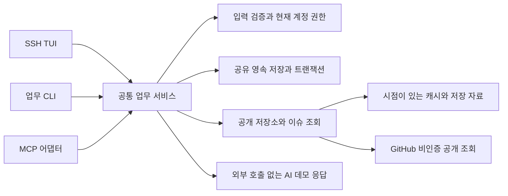

# Terminal-World 설계 결정 기록

- 검토일: 2026-11-07 (Asia/Seoul, 작업일 표시)
- 상태: 1단계 근거 검토 초안. 2026-11-08 전체 기능 데모 목표로 진행 재개. 미결정 정책은 각 구현 단계에서 다루며 설계 확정·구현 완료를 의미하지 않는다.
- 기준: [최신 결정](2026-11-02.md), [요구사항](requirements-analysis.md), [모델](analysis-models.md), [분석 산출물](analysis-deliverables.md).
- 권한: 2026-11-08 사용자가 1차 목표를 전체 기능 데모 구현으로 지정하고 단계별 착수를 요청했다. 로컬 설계·구현·검증을 진행한다. 커밋·푸시·구매·공개 배포는 별도다.
- 진행 기준: [전체 기능 데모 계획](demo-plan.md). 미결정 외부 서비스 정책은 해당 기능 단계에서 확인하며 공통 기반 설계를 막는 선행 승인으로 취급하지 않는다.
- 2026-11-08 외부 연결 결정: GitHub 계정을 연결하지 않고 공개 인기 저장소·이슈 자료를 표시한다. AI 모델은 실제 연결하지 않고 데모 응답을 사용한다. 아래의 과거 AI 제공자·예산 검토는 1차 데모의 선행 조건이 아니다.

## 1. 선행 자료와 기존 계획

2026-10-25·26·27 결정 기록은 이력으로 유지하고 충돌 시 2026-11-02 범위를 우선한다. 분석 문서와 분석 ZIP은 변경하지 않는다. 이 문서는 분석 요구사항을 덮어쓰지 않는 상세 설계 결정 기록이다.

기존 `.gjc/_session-01a16445-c707-7474-a132-5bb7a1c81745/plans/ralplan/01a16445-c707-7474-a132-5bb7a1c81745/pending-approval.md` 및 같은 세션의 `ultragoal/brief.md`를 확인했다. 전자는 승인 대기 표기를 남기지만 후자는 로컬 TUI 프로토타입의 승인 기록이며 실제 SSH·인증·네트워크를 제외한다. 이번 다중 사용자 설계와 다른 목적이므로 재개·변경하지 않는다. `strategy-lab/community-study/PLAN.md`는 2026-10-30 완료된 커뮤니티 조사다. 확인한 계획 중 이번 목적의 미완료 설계 계획은 없으며 새 workflow 계획을 만들지 않고 현재 작업 추적과 이 결정 기록을 사용한다.

현재 구현 근거:

| 파일 | 확인 내용 | 설계 시 주의 |
|---|---|---|
| `package.json`, `src/cli.tsx` | TypeScript·React·Ink 기반 로컬 TUI, CLI는 help/version/no-mouse 및 TTY 진입 | FR-26의 비대화형 업무 CLI가 구현된 것으로 보지 않음 |
| `src/model.ts` | `user:local` 한 명, 로컬 채팅·예시 사용자 방명록, grapheme 길이 검증 | 공통 계정·권한 모델이 아님. 최신 NFC 코드포인트 정책을 그대로 충족한다고 간주하지 않음 |
| `src/storage.ts` | 로컬 JSON 스냅샷, 단일 작성자 잠금, 저장 확인 및 불확실 결과 처리 | 공유 서버 DB·회수 검증 경계가 아님. 확인 후 성공 표시 원칙은 참고 가능 |
| `src/App.tsx` | 로컬 모델과 commit을 연결하는 화면 상태 | SSH·CLI·MCP별 업무 로직을 이 화면에 복제하지 않음 |

## 2. 확인한 외부 사실

아래는 이번 조회에서 읽은 공식 문서다. 외부 요금·한도는 변할 수 있으며 계정의 실제 사용 가능 여부나 성능을 검증한 것은 아니다. 버전 고정 문서를 최신 버전이라고 단정하지 않는다.

| 근거 | 출처 | 확인 사실과 한계 |
|---|---|---|
| E-01 | [GitHub 저장소 검색](https://docs.github.com/en/search-github/searching-on-github/searching-for-repositories) | stars·forks·created·pushed·language·topic·license 조건이 있다. `size`는 저장소 용량이며 커뮤니티 규모가 아니다. 이 검색 규격은 중소규모·신생의 제품 임계값을 정해주지 않는다. |
| E-02 | [GitHub REST 한도](https://docs.github.com/en/rest/using-the-rest-api/rate-limits-for-the-rest-api) | 비인증 공개 조회 기본 60회/시간/IP, 일반 사용자 인증 기본 5,000회/시간. 검색은 더 엄격한 별도 한도, 인증 방식별 예외 및 2차 한도가 있다. 응답 한도 헤더·403/429에 대응해야 하며 기본 숫자를 서비스 처리량으로 약속하지 않는다. |
| E-03 | [GitHub REST 권고](https://docs.github.com/en/rest/using-the-rest-api/best-practices-for-using-the-rest-api) | 조건부 GET과 ETag/Last-Modified, 직렬 큐, Retry-After/reset 및 증가 대기를 권고한다. 올바른 Authorization이 있는 304는 1차 한도에 산입하지 않는다. 모든 조회가 무료라는 뜻은 아니다. 404는 접근권한 문제일 수도 있어 삭제로 단정하면 안 된다. |
| E-04 | [MCP 2025-11-25 전송](https://modelcontextprotocol.io/specification/2025-11-25/basic/transports) | UTF-8 JSON-RPC, stdio와 Streamable HTTP를 정의한다. stdio stdout에는 MCP 메시지만 출력한다. HTTP 스트림·프로토콜 세션은 업무 접속·집중 세션과 같은 개념이 아니다. |
| E-05 | [MCP 2025-11-25 인증](https://modelcontextprotocol.io/specification/2025-11-25/basic/authorization) | HTTP 인증은 OAuth 기반이며 보호 자원 메타데이터/인증 서버 발견을 규정한다. stdio는 같은 HTTP 인증 흐름을 그대로 적용하지 않는다. 서비스의 자격 만료 기간을 대신 결정해주지는 않는다. |
| E-06 | [Anthropic API 가격](https://platform.claude.com/docs/en/about-claude/pricing) | 모델별 입력·출력·캐시 비용을 USD/백만 토큰으로 구분한다. 조회 표의 Haiku 4.5는 기본 입력 $1·출력 $5/백만 토큰. 이는 비교용 가격 관측이지 모델 선정·가용성 보장·예산 승인이 아니다. |
| E-07 | [OpenAI 가격 조회](https://openai.com/api/pricing/) | 조회가 business/pricing 페이지로 이동했고 모델별 단가를 확보하지 못했다. 이 근거로 단가 비교나 최저가 주장을 하지 않는다. |

유료 모델 호출·외부 자격 발급·실제 GitHub 수집은 하지 않았다. 한국어 설명 정확성, 근거 충실도, 제공자 데이터 처리 조건과 계정별 모델 가용성은 제공자 최종 선정 전에 추가 검토해야 한다.

## 3. 결정 후보와 사용자 확인 항목

아래의 **추천**은 아직 승인된 정책이 아니다. 기존 확정 규칙과 추천을 구분한다. 숫자가 비어 있는 항목은 임의 기본값으로 구현하거나 확정 요구사항으로 취급하지 않는다.

### D-01 오픈소스 선정 기준 — 지표·구간 승인, 기간 미확정

- 추적: FR-29·FR-30 / UC-17 / 요구사항 5.16절.
- 확정: 공개·오픈소스 라이선스 확인, 중소규모·신생 우선, 근거·자료 시점 표시. 스타만으로 난이도·품질·활동성을 판정하지 않는다. 미확인 기준은 미분류다.
- 사용자 결정 Q-01: **스타 수 기반 인지도 구간**을 선택했다. 규모는 인지도 대리지표로 명시하고 신생·활동성·트렌드는 별도 표시한다. 기여자·활동 복합 지표는 채택하지 않는다. 구간 숫자·기간·트렌드 산식까지 승인한 것은 아니다.
- 대안: 기여자 수·최근 활동을 합친 규모 지표. 유지보수 공동체에 가까울 수 있지만 기간·봇/중복 처리·집계 비용 등 추가 정책이 필요하다.
- 신생 추천: GitHub 저장소 생성일 기준 경과 기간으로 표시하되 프로젝트 최초 탄생일이라고 단정하지 않는다.
- 트렌드 추천: 동일 관찰 창의 스타 수 순증을 자체 관측값으로 표시한다. 두 시점 자료가 없거나 관찰 창이 부족하면 미확인. 누적 스타 수나 최근 push만으로 트렌드라고 부르지 않는다. 순증은 신규 스타 이벤트 수와 다르다.
- 선정 추천: 언어·분야·관심사에 맞는 공개 열린 이슈를 대상으로 각 축의 근거를 독립 표시한다. `good first issue`는 관리자가 붙인 라벨이지 쉬움·수락 보장이 아니다. 모든 축 동시 충족을 필수로 하면 신생 후보를 누락시킬 수 있다.
- 미결정: 신생 기간 → 트렌드 관찰 창·선정 방식·최소 근거 → 후보 우선순위. 각각 한 번에 하나씩 확인한다.
- 사용자 결정 Q-02: **소규모 0~999스타·중규모 1,000~9,999스타**를 선택했다. 검증된 시장 기준·수요 증거가 아닌 사용자 승인 운영 정책이다. 관측된 0과 미확인 값은 구별한다. 구간 밖 저장소의 신생·트렌드 후보 포함 여부는 별도 선정 규칙으로 결정한다.
- Q-03 제안(미승인): GitHub 저장소 생성 시각부터 365일 미만을 신생으로 표시한다. 대안은 180일 미만이다. 추천은 초기 이슈가 형성될 시간을 폭넓게 포함하는 운영 정책이며 프로젝트 실제 창립일·수요를 추정하지 않는다. 생성 시각 미확인은 미분류다.
- 2026-11-08 추가 결정: 공개 인기 저장소 목록도 시연한다. 인기 목록은 누적 스타 수 순위를 표시하며, 중소규모·신생 우선의 기여 이슈 탐색과 분리한다. 누적 스타 수를 최근 성장 추세나 기여 적합성의 증거로 쓰지 않는다.

### D-02 GitHub 공개 자료 — 비인증 API·캐시·저장 자료 조합

- 추적: FR-29·FR-30 / UC-17.
- 추천: 서버가 공개 자료를 공통 캐시하고 동일 조회를 합친다. 주기 수집은 제한된 후보 집합에 적용하고 상세 요청 시 필요에 따라 재검증한다. ETag 조건부 조회, 요청 큐, 한도 헤더 및 Retry-After에 따른 중단·재시도를 적용한다(E-02·03).
- 사용자 결정: GitHub 계정 연결을 제공하거나 요구하지 않는다. 1차 데모는 공개 비인증 요청으로 구현하며 OAuth·PAT 발급·환경의 기존 GitHub 자격 자동 사용을 도입하지 않는다. 향후 운영 자격의 검토는 이번 데모와 별개다.
- 오류: 한도 소진·통신 실패·접근 불가·닫힘을 빈 결과와 분리한다. 마지막 자료를 제공하면 확인 시점과 최신 여부 미확인을 표시한다. 404는 삭제/접근 불가를 확정적으로 구별할 수 없으면 그대로 안내한다.
- 미결정: 수집 대상 규모, 목록/상세/추세 관측 주기, 허용 자료 노후 기간. 호출 비용은 대상 수×페이지 수×갱신 횟수 및 상세 요청량으로 산정한 후 주기를 제안한다. 304 비율을 확인 없이 가정하지 않는다.
- 인수 초점: 403/429에서 폭주하지 않음, 같은 요청 합치기, 오래된 자료 표시, 닫힌 후보 제외. 제외된 성능 목표를 다시 도입하지 않는다.

2026-11-08 방식 비교:

| 방법 | 이점 | 한계 | 1차 데모 적용 |
|---|---|---|---|
| GitHub 공개 REST 검색 | 계정 연결 없이 실제 저장소·이슈·스타·언어·라이선스 자료 조회 | 비인증 IP/검색 한도, 네트워크 실패, 부분 결과 | 기본 조회 수단. 서버가 공통 캐시·요청 합치기·요청 큐를 관리 |
| 확인된 공개 자료 스냅샷 | 시연 재현성, 네트워크/한도 문제 중에도 탐색 가능 | 수집 이후 순위·이슈 상태가 변함 | 마지막 확인 시점·출처·현재 상태 미확인과 함께 제공. 최신 순위로 표시하지 않음 |
| GitHub Trending 공개 화면 수집 | GitHub가 표시하는 인기 상승 후보를 참고 가능 | HTML 구조 변경에 따른 유지보수와 수집 실패 가능성 | 보조 후보. 1차 필수 수단으로 채택하지 않음 |
| 제3자 공개 피드/데이터 | 특정 기간·분야를 보완할 수 있음 | 출처·갱신·제공 조건·지속성 추가 검증 필요 | 기본 의존성으로 도입하지 않음 |

- 결정: 비인증 공개 REST 검색 + 공통 캐시 + 출처/시점이 있는 저장 자료. 캐시·스냅샷 미보유 상태의 실패는 빈 목록으로 가장하지 않는다.
- 인기 목록은 `GET /search/repositories`의 `sort=stars&order=desc`와 언어/분야 조건을 사용한다. 질의에 해당하는 결과임을 표시하며 GitHub 전체의 완전한 순위라고 주장하지 않는다. 라이선스 미확인은 오픈소스로 확정하지 않는다.
- 공개 이슈는 `GET /search/issues`의 `is:issue is:open` 및 대상 저장소 조건으로 검색하며 PR과 구별한다. 인증이 필요한 semantic/hybrid 검색은 이번 범위에 도입하지 않는다.
- 공식 근거: [저장소 검색·비인증 허용·스타 정렬](https://docs.github.com/en/rest/search/search#search-repositories), [공개 이슈 검색](https://docs.github.com/en/rest/search/search#search-issues-and-pull-requests), [비인증 기본 한도](https://docs.github.com/en/rest/using-the-rest-api/rate-limits-for-the-rest-api#primary-rate-limit-for-unauthenticated-users), [한도/조건부 조회 처리](https://docs.github.com/en/rest/using-the-rest-api/best-practices-for-using-the-rest-api), [Trending 공개 화면](https://github.com/trending).
- 검색 한도와 일반 요청 한도는 별도로 응답 헤더를 확인한다. 비인증 ETag/304를 호출 한도에서 항상 제외된다고 계산하지 않는다. 인증된 304에 대한 공식 예외를 비인증 요청에 확대하지 않는다.
- 실행 근거: 2026-11-08, 인증 헤더 없는 저장소 검색 1회가 HTTP 200·3개 결과·`incomplete_results=false`를 반환했다. 조회 가능성만 확인했으며 제품 목록/캐시/장애 처리는 아직 구현하지 않았다.

### D-03 AI 설명 — 1차 데모는 외부 모델 연결 없음

- 추적: FR-30 / UC-17.
- 사용자 결정(2026-11-08): 실제 AI 모델을 연결하지 않는다. API 키·제공자 계약·유료 호출·실제 모델 예산을 데모 선행 조건으로 두지 않는다.
- 데모: 자료와 연결된 준비 응답으로 요약·필요 배경지식·추천 이유·원문 근거 화면을 시연한다. TUI·CLI·MCP 결과에 `데모 응답`을 명시하고 실제 AI 생성이라고 표시하지 않는다. 원본 자료가 맞지 않거나 준비 응답이 없으면 설명 없음으로 처리한다. 설명 실패·근거 부족 상태도 준비 데이터로 시험한다.
- 검증 범위: 설명 UI·자료 연결·데모/실제 구분·설명 없음 처리까지다. FR-30의 실제 모델 생성·사실 충실도·품질·호출 비용 검증은 완료로 판정하지 않는다.
- 아래는 1차 데모 이후 실제 연결을 검토할 때의 과거 후보이며 이번 단계에 적용하지 않는다.
- 추천: 서버 관리 단일 제공자의 저비용 텍스트 모델을 후보로 평가하고, 사용자가 이슈 설명을 요청할 때 생성한다. 이슈 자료 버전·탐색 조건·모델/프롬프트 버전이 같은 설명은 재사용한다. 일괄 선생성·자동 고가 모델 전환은 추천하지 않는다.
- Haiku 4.5는 확인된 단가가 있는 비교 후보일 뿐 확정 모델이 아니다. 다른 제공자와의 가격·한국어 품질 비교는 미완료다.
- 비용 계산: 비캐시 입력 토큰×입력 단가 + 출력 토큰×출력 단가 + 해당 캐시/부가 비용. 실패·재시도 과금도 포함하며 호출 전에 예상 최대 비용을 예약하고 동시 요청이 같은 잔액을 중복 소비하지 않도록 설계한다.
- 추천: 월 총액 상한과 요청당 입력/출력 한도를 둔다. 상한 도달 시 새 생성만 중지하고 원문 탐색과 유효한 기존 설명은 유지한다. 게스트 설명 조회 허용은 유지하되 공통 생성 예산을 우회할 수 없게 한다.
- 미결정: 비용 부담 주체, 통화·월 예산·정산 경계, 게스트/회원 간 생성 배분, 제공자·모델, 입력/출력 한도. 금액·호출 수를 임의 확정하지 않는다.

### D-04 CLI·MCP 규격 — 상세 설계 후보

- 추적: FR-26·FR-27·FR-28 / UC-15·UC-16, 각 업무 UC.
- 추천: CLI는 `terminal-world <자원> <동작>` 형태, 일반 입력은 인수/파일/stdin, 구조화 출력은 JSON, 진단은 stderr로 구분한다. 도움말·페이지 이어받기·실패 종료 상태·결과 미확인을 명세한다. 구체 명령/스키마는 4단계에서 확정한다.
- MCP는 로컬 stdio 어댑터와 원격 Streamable HTTP를 비교한다. 원격 공유 서비스에는 Streamable HTTP가 직접적이나 OAuth 연동 및 대상 호스트 지원을 검증해야 한다. stdio도 공통 서버에 연결해야 하며 로컬 업무 데이터 사본을 만들지 않는다.
- 미결정: 우선 지원 MCP 호스트와 전송 방식, 프로토콜/SDK 버전. 두 방식을 근거 없이 동시에 필수화하지 않는다.
- 지속 연결·구독은 명시적인 업무 세션으로 구분한다. MCP 초기화·HTTP 재접속·단발 CLI 요청만으로 온라인이나 집중시간이 생겨서는 안 된다.
- 도구 발견, 입력/출력 스키마, 프로토콜 오류/업무 오류 구분은 도구 규격 원문 추가 검토 후 4단계에 구체화한다. 삭제된 FR-21을 일반 장애 요구사항으로 복원하지 않는다.

### D-05 보호된 인증·연동 만료 — 사용자 정책 결정 필요

- 추적: FR-03·FR-04·FR-22·FR-23·FR-28 / UC-02·UC-11·UC-12·UC-15·UC-16, 관리자 작업 UC-08·UC-13·UC-14.
- 확정: 서비스 계정으로 인증, 작업·대상 허용 범위와 현재 계정 권한의 교집합, 유한 만료, 회수, 민감 입력의 모델/명령 이력/일반 로그 비노출.
- 추천: 인증·동의는 사람이 조작하는 보호된 경로에서 수행하고 모델 도구 인수에 비밀번호·복구 코드·토큰을 넣지 않는다. CLI 직접 보호 입력/SSH 승인 경로와 MCP HTTP OAuth의 결합 가능성을 검토한다. 브라우저 인증이 필요한 안은 웹 커뮤니티 개발과 구분하되 사용자 동의 없이 필수 전제조건으로 확정하지 않는다.
- 추천: 토큰의 만료만 기다리는 방식 대신 서버의 현재 계정·연동 회수 상태·권한을 요청마다 검증한다. 쓰기 트랜잭션과 회수 사이의 경쟁에서도 회수 완료 이후 승인되는 새 쓰기를 차단하도록 경계를 설계한다.
- 구분: 연동 승인 수명, access token 수명, 갱신 자격 수명, 지속 업무 세션 생존 여부는 별개다. 갱신을 허용해도 명시적 연동 승인 만료를 무한 연장하지 않는다. 각 기간 숫자는 미정이다.
- 기존 계정 정책: 복구는 모든 세션·연동 무효화; 비밀번호 변경은 현재 세션·복구 코드 유지, 다른 세션·모든 연동 무효화; 탈퇴는 모든 자격 무효화. CLI/MCP에서 비밀번호 변경 시 현재 업무 세션과 무효화할 연동 자격을 동일 객체로 취급하지 않는 상세 모델이 필요하다.
- 미결정: 사용자 인증 경로, 만료/재인증 부담, 갱신 허용 여부와 기간, 관리자 연동의 추가 제한. 복구 코드의 기존 무기한 유효 정책과 연동 자격의 유한 만료를 혼동하지 않는다.

### D-06 공통 업무 경계 — 설계 초안과 입력 검증 첫 구현

기존 TypeScript 코드에서 출발해 하나의 공통 업무 서비스를 만들고 TUI·CLI·MCP는 같은 서비스를 호출한다. 각 화면이나 도구에 계정·권한·보존 규칙을 복제하지 않는다. 서버 분리·저장 엔진·SSH 실행 경로·MCP 전송 방식의 구체 기술 선택은 다음 설계 항목이다.

- 가입은 계정·개인 공간·초기 자격을 같은 원자적 저장 단위에서 생성한다. 정규화한 아이디/닉네임의 중복 방지는 저장소가 동시 요청에서도 보장해야 한다. 입력 검증만으로 중복 방지가 완료됐다고 보지 않는다.
- 단발 요청 자격과 지속 접속 세션을 구분한다. 집중 시작·단절 처리는 지속 세션에 연결하고, 계정 권한·자격 회수는 공통 업무 경계에서 검증한다.
- 공개 GitHub 자료는 계정별 사본을 만들지 않고 공통 캐시를 사용한다. AI 데모 응답은 해당 원본 자료와 연결하며 현재 데이터에 맞는 준비 응답이 없으면 설명 없음으로 반환한다.
- 첫 구현: `src/service/validation.ts`와 `tests/service-validation.test.ts`. 최신 명세의 입력 형식·NFC/코드포인트 길이·터미널 제어문자 거부·ASCII 아트·4개 테마·복구 코드 입력을 검증한다. 비밀번호를 정규화로 변경하거나 비ASCII 복구 문자를 ASCII로 변환해 통과시키지 않는다.
- 현재 한계: 검증 모듈을 실제 업무 서비스나 기존 화면에 연결하기 전이다. 계정/권한/저장·SSH·CLI·MCP 연결 완료를 의미하지 않는다. 신규 의존성은 추가하지 않았다.

## 4. 설계 진행과 검증 경계

1. 현재: D-01~05의 근거와 추천을 정리했고 Q-01 규모 지표·Q-02 구간 선택을 기록했다. Q-03 신생 기간은 미결정이며 이슈 기능 구현 전에 확정한다. 사용자 답변을 이 문서에 결정·근거·영향·상태로 누적한다.
2. 진행 중: D-06에 공통 업무 경계 초안을 정리하고 입력 검증을 구현·시험했다. 저장·인증 구조를 구체화하고 가입·로그인·개인 공간 생성에 연결한다. 각 기능에만 필요한 미결정 정책은 해당 단계에서 처리한다.
3. 시퀀스는 UC-06×UC-15/16의 동일 계정 조회/작성과 자격 회수 후 쓰기 거부부터 검토한다. 회수 후 재시도에서도 과거 성공 결과 반환과 새 쓰기 허용을 구별한다.
4. ERD·CLI·MCP·외부 인터페이스를 구체화하고 FR/UC별 구현 단계·인수 기준으로 연결한다.
5. 근거 검토 이후 공통 구조 설계를 시작한 상태이며 구조 설계·상세 설계·전체 기능 구현 완료를 주장하지 않는다.

범위 점검: 보류된 페어 프로그래밍·활동 카드·원클릭 준비, 제외된 이슈 작업실·코드 실행·GitHub 쓰기·PR 후속 관리·웹 커뮤니티·지원자 관리·팀 협업을 도입하지 않았다. 모집은 FR-31/UC-18의 기존 게시글 특수화로 유지한다. 응답시간·처리량·RPO/RTO 수치를 새 요구사항으로 추가하지 않았다.

검증 방법: 본 문서의 FR/UC 식별자와 로컬 문서 링크를 원본과 대조하고, git diff로 변경 경계를 확인한다. 외부 문서 읽기는 구현·상호운용·유료 호출 시험이 아니다.
