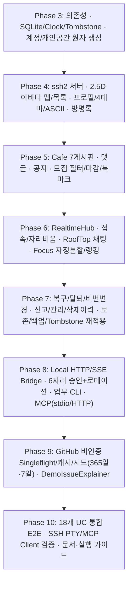

# Terminal-World 전체 기능 데모 구현 계획 (Phase 3~10)

- 작성·승인일: 2026-11-28 (Asia/Seoul)
- 상태: **승인 완료 — 새 세션에서 Phase 3부터 즉시 착수 가능**
- 기준 문서: [요구사항 분석 명세](requirements-analysis.md), [유스케이스·도메인 모델](analysis-models.md), [설계 결정 기록](design-decisions.md), [아키텍처·데이터 설계](architecture-spec.md), [인터페이스·화면 설계](interface-spec.md), [전체 기능 데모 계획](demo-plan.md)

---

## 1. 승인된 실행 조건 (2026-11-28 확정)

1. **실행 방식**: **Phase 3 → 10을 단계별 빌드·타입체크·테스트 통과를 확인하며 연속 완주**한다.
2. **SSH 호스트 키 관리**: `terminal-world serve` 최초 기동 시 `--data-dir/ssh_host_ed25519.key`(`0600`)를 자동 생성·재사용한다.
3. **의존성 및 호환성**:
   - 신규 런타임 의존성 3종(`ssh2`, `@modelcontextprotocol/sdk`, `zod`) + 타입(`@types/ssh2`)만 추가한다. SQLite·암호화는 Node 22+/24 내장 `node:sqlite`, `node:crypto`를 사용한다.
   - 기존 무인수 `terminal-world [--no-mouse]` 로컬 프로토타입 실행 경로와 `~/Library/Application Support/Terminal World/state.json` 및 기존 66개 테스트·`tests/package.test.mjs`를 보존한다. 신규 다중 사용자 기능은 서브커맨드(`serve`, `auth`, `world`, `profile`, `guestbook`, `board`, `recruit`, `notice`, `chat`, `focus`, `report`, `admin`, `oss`, `mcp`)로 라우팅하고 서버 데이터는 별도 디렉터리(기본 `./.terminal-world-data/`)에 저장한다.
4. **불변 경계**: 기존 분석 원본 문서(`docs/requirements-analysis.md`, `docs/analysis-models.md`, `requirement-analysis.zip`)는 수정하지 않는다. 보류·제외 범위(2026-11-02)와 성능/RPO/RTO 제외 결정(5.14절)을 준수한다.
5. **커밋 규칙**: 모든 `git commit` 메시지 마지막에는 빈 줄 뒤에 `Co-authored-by: Gemini <200291788+gemini-code-assist@users.noreply.github.com>`를 반드시 포함한다([AGENTS.md](../AGENTS.md)).

---

## 2. 단계별 구현 로드맵 (Phase 3 ~ Phase 10)

### Phase 3: 공통 기반, SQLite 저장소, 계정·인증·개인 공간 원자 생성 (`UC-02`, `FR-03~05`)
- **변경/신규 파일**:
  - `[MODIFY]` `package.json`: `ssh2`, `@modelcontextprotocol/sdk`, `zod`, `@types/ssh2` 추가 및 `npm test`를 `tsconfig.test.json` 전체 테스트 실행으로 전환
  - `[NEW]` `tsconfig.test.json`
  - `[NEW]` `src/core/clock.ts` (`Clock`, `FakeClock`, `Asia/Seoul` 자정 분할 유틸), `src/core/errors.ts` (`ServiceError`), `src/core/crypto.ts` (`scrypt`, 32자리 복구 코드, 토큰/승인 코드 해싱)
  - `[NEW]` `src/store/sqlite/migrations.ts`, `src/store/sqlite/database.ts` (`node:sqlite` WAL + 전체 ERD 스키마 + `BEGIN IMMEDIATE` + `tombstones.log` + `VACUUM INTO` 기반)
  - `[NEW]` `src/core/auth-service.ts` (원자 가입·개인 공간 `grid_slot`·복구 코드 1회 반환, 대소문자 무시 로그인, 5회 실패 5분 잠금, `setMemberRole`)
  - `[NEW]` `tests/core-auth.test.ts`
- **완료 게이트**: `npm run typecheck && npm run build && npm test` 통과(기존 66개 + 신규 동시 가입 중복 방지·잠금·재시작 복원 테스트).

### Phase 4: SSH 서버, 2.5D 아바타 자유 이동 맵·목록 TUI, 프로필·방명록 (`UC-01`, `UC-03~05`, `FR-01~02`, `FR-06~09`, `FR-20`)
- **변경/신규 파일**:
  - `[NEW]` `src/core/profile-service.ts`, `src/core/guestbook-service.ts` (4테마·40×12 ASCII·기술 스택·HTTPS URL·보관 방명록 포함)
  - `[NEW]` `src/ssh/ssh-server.ts` (`ssh2`, `--data-dir/ssh_host_ed25519.key` `0600` 자동 생성/로드, `createTerminalInput` 재사용, `window-change` 리사이즈 어댑터, 세션별 React `ErrorBoundary` 격리)
  - `[NEW]` `src/tui/world-map.ts` (2.5D 아바타 자유 이동 타일 맵 엔진: 공용 5공간+오픈소스 탐색소+동적 개인 터미널 슬롯, 충돌·문 감지·카메라 패닝·타 접속자 아바타, 확대/축소 없음)
  - `[NEW]` `src/tui/components/` (`MultilineInput.tsx`, `SecretInput.tsx`, `ConfirmDialog.tsx`, `PreviewPane.tsx`, `Themes.ts`)
  - `[NEW]` `src/tui/WorldApp.tsx`, `src/tui/screens/` (진입 게이트, `120×30+` 2.5D 맵 ↔ `m` 목록 탐색 `80×24` 폴백, 개인 공간/편집/방명록)
  - `[NEW]` `tests/world-map-and-ssh.test.ts`
- **완료 게이트**: 2.5D 이동·패닝·폴백·프로필/방명록 권한·실제 로컬 SSH 소켓 접속 테스트 통과.

### Phase 5: Cafe 7개 게시판, 댓글, 공지, 모집 게시판 (`UC-06`, `UC-08`, `UC-18`, `FR-10~12`, `FR-15`, `FR-31`)
- **변경/신규 파일**:
  - `[NEW]` `src/core/board-service.ts`, `src/core/recruitment-service.ts`, `src/core/notice-service.ts`
  - `[NEW]` `src/tui/screens/CafeScreen.tsx`, `RecruitmentScreen.tsx`, `LobbyScreen.tsx`
  - `[NEW]` `tests/core-community.test.ts`
- **완료 게이트**: 7개 게시판, 원글/댓글 연쇄 삭제, 모집 필터·`Asia/Seoul` 자동 마감·비공개 북마크, 관리자 공지 권한 테스트 통과.

### Phase 6: 실시간 접속·자리 비움, RoofTop 채팅, Focus Room 집중/랭킹 (`UC-07~10`, `FR-13~14`, `FR-16~19`)
- **변경/신규 파일**:
  - `[NEW]` `src/core/realtime-hub.ts`, `src/core/presence-service.ts`, `src/core/chat-service.ts`, `src/core/focus-service.ts`
  - `[NEW]` `src/tui/screens/RoofTopScreen.tsx`, `FocusScreen.tsx`, `LivingRoomScreen.tsx`
  - `[NEW]` `tests/core-realtime-focus.test.ts`
- **완료 게이트**: 2인 실시간 채팅·멱등 중복 방지·14일 만료, 다중 세션 Living Room 통합 상태, 집중 시작 세션 단절 vs 타 세션 단절·자정 분할·공동 순위·타인 상세 차단 테스트 통과.

### Phase 7: 계정 복구·비밀번호 변경·탈퇴, 신고·관리·삭제 이력, 보존·백업 복구 (`UC-02`, `UC-11~14`, `FR-22~25`)
- **변경/신규 파일**:
  - `[NEW]` `src/core/account-lifecycle-service.ts`, `src/core/moderation-service.ts`, `src/core/retention-service.ts`
  - `[NEW]` `src/tui/screens/AccountSecurityScreen.tsx`, `AdminPanelScreen.tsx`
  - `[NEW]` `tests/core-lifecycle-moderation.test.ts`
- **완료 게이트**: 30분 복구 잠금·동시 복구 1회·비밀번호 변경 시 세션/연동 분리 무효화, 탈퇴 익명화·90일 이름 재사용 제한/해제, 신고 중복/3분 30건 제한, 관리자 권한 회수, `VACUUM INTO` 백업 복구 후 Tombstone·만료 재적용 테스트 통과.

### Phase 8: 연동 자격(6자리 승인·Access/Refresh 로테이션), 로컬 브릿지, 업무 CLI, MCP 서버 (`UC-15~16`, `FR-26~28`)
- **변경/신규 파일**:
  - `[NEW]` `src/core/integration-auth-service.ts` (6자리 승인 코드 5분, 일반 최대 30일/관리자 4시간, Access 1h/30m + 일회용 Refresh 7d/1h 로테이션, Replay 탐지 시 Grant 전체 회수, 쓰기 트랜잭션 내 회수·권한·멱등성 단일 경계)
  - `[NEW]` `src/bridge/http-bridge.ts` (`127.0.0.1:4310` JSON + SSE)
  - `[NEW]` `src/cli-cmd/router.ts`, `src/cli-cmd/client.ts` (전체 명령 트리, `--json`, `stderr` 분리, 종료코드 `0/2/3/4/5/6`, TTY 보호 입력, `chat watch`/`focus start --attach`)
  - `[NEW]` `src/mcp/tools.ts`, `src/mcp/stdio-server.ts`, `src/mcp/http-server.ts` (`stdio` 기본 + `--mcp-http` 선택, `HANDOFF_REQUIRED`, `untrustedContent: true`, `confirm: true`)
  - `[MODIFY]` `src/cli.tsx` (서브커맨드 라우팅, 기존 무인수 로컬 프로토타입 호환 유지)
  - `[NEW]` `src/server.ts` (`terminal-world serve` 부트스트랩 및 정상 종료 시 활성 집중 구간 마감)
  - `[NEW]` `tests/cli-mcp-auth.test.ts`
- **완료 게이트**: 6자리 승인·Refresh Replay 회수·회수 vs 쓰기 경합, CLI JSON/종료코드/지속 구독, `@modelcontextprotocol/sdk` 공식 Client(`stdio` 및 `Streamable HTTP`) 검증 통과.

### Phase 9: 공개 GitHub 저장소·이슈 탐색 및 데모 AI 설명 (`UC-17`, `FR-29~30`)
- **변경/신규 파일**:
  - `[NEW]` `src/discovery/github-client.ts` (비인증 REST, 환경 토큰 미사용, Singleflight, 직렬 큐, ETag, 403/429 쿨다운, 365일 신생·7일 트렌드 순증·인기/이슈 분리)
  - `[NEW]` `src/discovery/seed-snapshot.ts`, `src/discovery/demo-explainer.ts` (`mode: 'demo'`, `demoAuthoredAt`, `sourceCheckedAt`, 불일치/부재 시 `unavailable`), `src/core/discovery-service.ts`
  - `[NEW]` `src/tui/screens/OssDiscoveryScreen.tsx`
  - `[NEW]` `tests/discovery-demo-ai.test.ts`
- **완료 게이트**: 모의 GitHub HTTP 서버 대상 403/429 폭주 방지·Singleflight·닫힘/404 제외·365일/7일/미분류·데모 AI 표시 및 설명 없음 처리 통과.

### Phase 10: 전체 시연 통합 검증, 문서 갱신 및 마감
- **변경/신규 파일**:
  - `[NEW]` `tests/e2e-full-demo.test.ts` (1개 서버에 회원 A/B + 게스트 + 관리자가 SSH TUI·CLI·MCP `stdio`로 UC-01~UC-18 전 시나리오 동시 수행)
  - `[MODIFY]` `docs/demo-plan.md`, `README.md` (UC 시연표 및 서버/SSH/CLI/MCP 실행 안내 갱신)
- **최종 검증 게이트**:
  - `npm run typecheck && npm run build && npm test && npm run test:package`
  - `git status -s && git diff --check` (분석 원본 무변경 확인)
  - 로컬 실서버(`node dist/cli.js serve`) + OpenSSH(`120×30`, `80×24`) + CLI + MCP 프로토콜 클라이언트 시연 검증.
